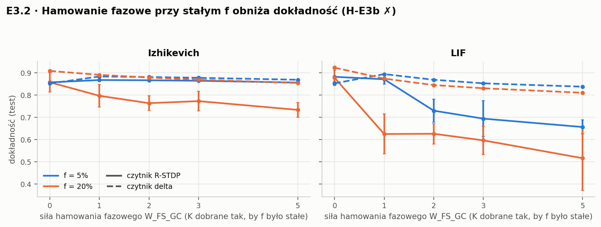
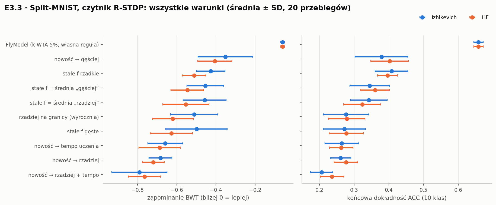
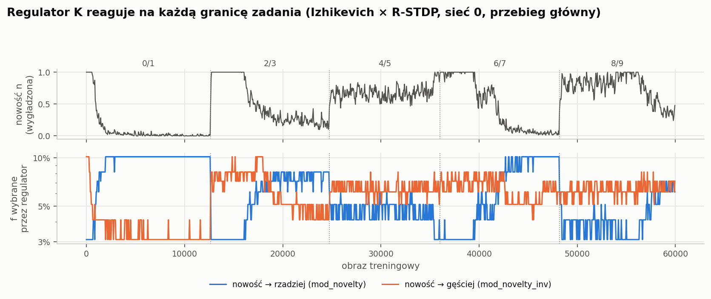

# E3 — rzadkość jako trzeci czynnik uczenia (MNIST, Split-MNIST)

*Utworzono 2026-10-12. Status (2026-10-26): **policzone i przeanalizowane** — E3.1–E3.6 i E3.6x (zadanie separacji na modelu skalibrowanym do skrawka). **Zacznij od sek. 0.***

Rozwinięcie wariantu M1 z [`ml_paper.md`](../../ml_paper.md) do konkretnego planu
eksperymentów. Ilustracja krok po kroku (cyfra → kod DG → czytnik → regulator K):
artefakt „Rzadki kod DG na MNIST” (https://claude.ai/artifact/CaNQ8PSbu6ysAXSFyqQecZ, prywatny).

> ⚠️ **Numeracja.** W [PLAN_BADAWCZY.md](../../PLAN_BADAWCZY.md) „E3” oznaczało
> niezbudowany eksperyment Sobol/LHS dla surrogatu ML. Od 2026-10-12 „E3” to ten
> eksperyment; Sobol/LHS przechodzi na „E3-S” (dalej niezbudowany).
>
> ⚠️ **Osobna baza kodu.** Cały kod E3 powstaje w `snn_separation`. Repo
> `snn_stdp_vs_surrogate_gradient` jest co najwyżej źródłem importu (zbiory danych,
> modele, algorytmy) albo katalogu z danymi — **nie modyfikujemy go i nie uruchamiamy
> E3 w nim** (inaczej niż sugerował `ml_paper.md` sek. 1 i 8).

---

## 0. Podsumowanie (2026-10-26) — przeczytaj najpierw

**Pytanie.** Czy rzadkość kodu warstwy DG, ustawiana hamowaniem tonicznym `K`, może
działać jak trzeci czynnik uczenia — tzn. czy sterowanie nią sygnałem nowości
zmniejsza zapominanie przy uczeniu kolejnych zadań (Split-MNIST, 5 zadań po 2 cyfry)?

**Krótka odpowiedź: to zależy — i wiemy od czego.** Czy „nowość → rzadszy kod” chroni
przed zapominaniem, wyznaczają dwie rzeczy:
1. **reguła, którą uczy się sieć** — przy regułach osłabiających wagi innych klas (R-STDP z
   R − R̄, reguła delta) rzadszy kod przy nowości zapomina *więcej*; przy regule, w której
   nagroda bramkuje tylko wzmacnianie (`rgate`), zapomina *mniej* — w każdej z 6
   architektur warstwy DG (E3.5);
2. **podobieństwo uczonych wzorców** — na zadaniu separacji wzorców w modelu
   skalibrowanym do skrawka rzadszy kod przy nowości pomaga dla mało podobnych wzorców,
   a dla bardzo podobnych pomaga kierunek odwrotny („nowość → gęściej”), zgodnie
   z Pérez-Montoyo i in. 2026 (E3.6x).

Po drodze trzy wyniki metodologiczne: optimum rzadkości dla uczenia istnieje, a miara
dekorelacji go nie widzi (E3.1); kontrola o dopasowanej średniej rzadkości zmienia wniosek
o modulacji (E3.3); samo hamowanie toniczne (globalny próg) nie wyrównuje aktywności
między wzorcami (E3.0, E3.4).

### Werdykty

| | hipoteza | wynik | figura |
|---|---|---|---|
| H-E3a | dokładność ma maksimum przy pośrednim f, a dekorelacja rośnie do ciszy | ✅ **potwierdzona** (4/4 kombinacje, 5/5 sieci) | fig. 1 |
| H-E3b | hamowanie fazowe przy stałym f nie zmienia dokładności | ❌ **obalona** — obniża dokładność | fig. 2 |
| H-E3c | nowość → rzadziej zapomina mniej niż stałe f o tej samej średniej | ❌ **obalona w przeciwnym kierunku** dla czytników R-STDP i delta, na dwóch zestawach sieci — ale przy czytniku bez osłabiania kierunek się odwraca (E3.5) | fig. 3, 4 |
| H-E3d | sterowanie rzadkością pomaga bardziej niż sterowanie tempem uczenia | ❌ brak różnicy | fig. 3 |
| H-E3e | nowość → gęściej zapomina mniej niż stałe f o tej samej średniej | ⚠️ **niepotwierdzona** wg kryterium (Izhikevich × R-STDP p = 0.28); kierunek dodatni w 8/8 porównaniach | fig. 3 |
| E3.4 | (eksploracyjnie) co decyduje o zapominaniu: kod czy reguła? | **reguła czytnika** | fig. 5 |
| **E3.5** | czy obalenie H-E3c jest odporne (6 architektur × 2 neurony × 3 czytniki)? | ❌ **nie** — przy czytniku bez osłabiania (`rgate`) „nowość → rzadziej” **zmniejsza** zapominanie we wszystkich 12 komórkach; przy R-STDP/delta zwiększa we wszystkich 24. Kierunek wyznacza reguła uczenia, nie architektura (sek. 12c) | fig. 7 |
| **E3.6** | to samo na zadaniu separacji wzorców (`dg_core`, R_in 0.5/0.75/0.9) | ❌ **obalenie nie przenosi się**: przy `rgate` „nowość → rzadziej” pomaga przy każdym R_in; przy R_in = 0.5 pomaga dla wszystkich czytników; przy dużym podobieństwie i R-STDP/delta pomaga kierunek odwrotny (sek. 12d) | fig. 8 |
| **E3.6x** | to samo na modelu skalibrowanym do skrawka (dane Madara) | ❌ obalenie nie przenosi się (6/9); kierunek zależy od **reguły i podobieństwa wzorców**: przy R_in 0.5 „nowość → rzadziej” pomaga (R-STDP, rgate), przy R_in 0.9 pomaga „nowość → gęściej” (sek. 12e) | fig. 9 |

### 1. Optimum rzadkości istnieje, dekorelacja go nie widzi


Dokładność czytnika rośnie, gdy kod gęstnieje od 1% do ~10–25% aktywnych
neuronów, potem spada. Dekorelacja `dec` zachowuje się monotonicznie — najwyższa
jest dla najrzadszego kodu, który daje najgorszą dokładność. To funkcjonalna wersja
wyniku E1 (STATUS sek. 3.3): **miara dekorelacji nagradza ciszę, nie użyteczność
kodu.** Przy okazji: kod DG nie jest lepszy od losowej projekcji o tym samym f
(zielona linia), jak w 1A.

### 2. Hamowanie fazowe przy stałym f szkodzi



Gdy `K` dobieramy tak, by f było stałe, dokładanie hamowania zwrotnego GC→FS→GC
obniża dokładność, mocno przy LIF i przy f = 20%. W E1′ hamowanie fazowe nie
zmieniało *separacji*; tu zmienia *użyteczność* kodu — na gorsze.

### 3. Sterowanie rzadkością nowością


Każdy punkt to jeden przebieg (sieć × kolejność zadań); na prawo od zera = pierwszy
warunek zapomina mniej. **Lewy panel:** „nowość → rzadziej” zapomina więcej niż stałe
f o tej samej średniej — w każdej kombinacji, w obu zestawach sieci. **Prawy panel:**
„nowość → gęściej” zapomina mniej, ale przy Izhikevichu z R-STDP w teście
potwierdzającym rozrzut jest duży i efekt nie przechodzi kryterium.



Wszystkie warunki dla czytnika R-STDP. FlyModel (k-WTA + reguła „tylko klasa
docelowa”) jest poza zasięgiem wszystkich wariantów sterowania rzadkością.



Regulator działa zgodnie z założeniem: nowość skacze na każdej granicy zadania.
Uwaga: w zadaniach 4/5 i 8/9 nowość nie opada do końca zadania, więc regulator trzyma
kod w stanie „nowym” przez całe zadanie.

### 4. O zapominaniu decyduje reguła czytnika


Ten sam kod, różne reguły: reguła FlyModelu (tylko wzmacnia wagi klasy docelowej)
prawie nie zapomina, R-STDP i delta (osłabiają wagi innych klas) zapominają dużo —
niezależnie od kodu. Reguła FlyModelu na kodzie DG prawie się jednak nie uczy: liczba
aktywnych neuronów na obraz waha się 18–242 (k-WTA: zawsze 100). Po normalizacji
kodu per obraz (wszystkie 40 przebiegów) ACC rośnie do 0.50 (izh) / 0.55 (lif) przy
zapominaniu −0.06; k-WTA nadal lepszy o 0.11–0.16.

### 5. Czy obalenie jest odporne? Sześć architektur, trzy reguły (E3.5)


Oś x: siła modulacji g (+1: nowość → rzadziej, −1: nowość → gęściej, 0: stały kod). Oś y:
o ile modulacja zapomina mniej niż stały kod o tej samej średniej rzadkości (> 0 = pomaga).
Kolory: 6 architektur (N = 500–5000, fan-in 10–100). **Wiersze R-STDP i delta:** krzywe
opadają we wszystkich 24 komórkach — rzadszy kod przy nowości szkodzi. **Wiersz rgate:**
krzywe rosną we wszystkich 12 komórkach — pomaga (+0.02 … +0.05; przy Izhikevichu kosztem
dokładności 0.73 vs 0.77, przy LIF bez kosztu). Kierunek nie zależy od architektury.

### 6. Zadanie separacji wzorców (E3.6, E3.6x)


Model `dg_core` (200 GC + FS + HMC), 10 prototypów o podobieństwie R_in, uczonych parami.
Figura 9: model skalibrowany do skrawka (dane Madara: GC 3.0 Hz, R_w 0.37, R_b 0.28, FS
9.6 Hz). Przy R_in = 0.5 „nowość → rzadziej” pomaga (R-STDP +0.13, rgate +0.02, 6/6); przy
R_in = 0.9 szkodzi (R-STDP −0.13) i pomaga kierunek odwrotny (+0.08 … +0.48). Reguła delta
zapomina silnie przy każdej modulacji w kierunku „rzadziej”. Na starej kalibracji (fig. 8)
kierunek zgodny w 6/9 komórkach. Zastrzeżenie: przy R_in 0.75–0.9 dokładności są niskie
(0.15–0.30).

### Co to znaczy

1. **Hipoteza „nowość → rzadszy kod jako trzeci czynnik” nie jest ani ogólnie prawdziwa,
   ani ogólnie fałszywa.** Jej znak wyznaczają reguła uczenia (odporne: 6 architektur,
   2 neurony, 2 zadania) i podobieństwo wzorców (E3.6x).
2. **Kontrola o dopasowanej średniej rzadkości zmienia wniosek.** Bez niej część pozornego
   zysku z modulacji to po prostu niższa średnia aktywność (np. „nowość → gęściej” vs kod
   gęsty: +0.19; vs stały kod o tej samej średniej: +0.14 i +0.07 na nowych sieciach).
   Prace o modulacji progów (Nm-SNN) takiej kontroli nie mają.
3. **Do uczenia bez zapominania ważniejsze od poziomu rzadkości są** reguła czytnika, która
   nie osłabia innych wag, i wyrównanie aktywności per wzorzec (k-WTA / hamowanie zależne od
   aktywności). Normalizacja kodu DG per obraz odzyskuje większość dokładności reguły
   FlyModelu (0.20 → 0.50–0.55), ale k-WTA nadal wygrywa o 0.11–0.16 (E3.4).
4. **Zgodność z biologią:** kierunek „słabsze hamowanie przy kodowaniu podobnych
   wzorców” (E3.6x) pasuje do Pérez-Montoyo i in. 2026.
5. Wyniki E3.1 i E3.3 (kontrola) pasują do artykułu metodologicznego (wariant (a) w STATUS
   sek. 4.1) jako funkcjonalny odpowiednik E1 / E1′.

### Dalsze kroki (propozycja)

1. **Kalibracja: efekt gabazyny.** Model skrawka trafia kontrolę, ale −30% FS→GC daje ×1.25
   zamiast ×1.6 (`calib_exvivo/README.md`). Kandydaci: dłuższe IPSC, heterogeniczne GC,
   komórki HIPP (hamowanie dendrytyczne).
2. **Przewidywanie dla eksperymentu z gabazyną (Ola, Kinga)** — zapisać przed analizą danych.
3. **Mechanizm zależności od podobieństwa wzorców** (E3.6x): więcej poziomów R_in, czytnik
   rgate z wyższą dokładnością, więcej sieci.
4. **E3.7: sieć uczona R-STDP z warstwą ukrytą** (sek. 6d) — czy wniosek o regule
   przenosi się na sieć wielowarstwową.
5. **Hamowanie zależne od aktywności zamiast globalnego progu** — co w DG wyrównuje
   aktywność między wzorcami?
6. **Decyzja co do artykułu ML (M1):** teza „rzadkość jako trzeci czynnik” w wersji
   warunkowej (reguła × podobieństwo) jest teraz poparta — do przemyślenia pozycjonowanie.

Szczegóły niżej: implementacja sek. 11, wyniki z liczbami sek. 12–12e, literatura
sek. 13, ograniczenia sek. 14.

---

## 1. Pytanie i motywacja

W `snn_separation` zmierzyliśmy, że w obwodzie DG zmienną dominującą jest
**odsetek aktywnych komórek ziarnistych** `f`, a hamowanie toniczne `K_GC` ustawia go
jednym skalarem (próg `G_crit = 4 + K`). Hamowanie fazowe przy wyrównanym `f`
nie zmienia separacji (STATUS sek. 3.4), a miara dekorelacji rośnie aż do ciszy
(sek. 3.3), więc nie mówi, ile rzadkości jest *użyteczne*.

E3 zamienia to w pytanie o funkcję:

> **Czy sterowanie gęstością kodu (`K`) sygnałem nowości zmniejsza zapominanie
> bardziej niż ta sama średnia gęstość ustawiona na stałe?**

Uczciwa motywacja (za `ml_paper.md` sek. 7.3): nie „DG świetnie separuje, więc go
skopiujmy”, tylko *„zmierzyliśmy, że rzadkość jest tu zmienną dominującą — uczyńmy
ją zmienną sterowaną i sprawdźmy, czy to pomaga w uczeniu”*.

### Dwa czynniki trzecie

| | **B — nagroda** | **A — nowość** |
|---|---|---|
| sygnał | `R = ±1` po odpowiedzi czytnika | nowość `N` (błąd / niepewność czytnika) |
| działa na | **czy** zmienić wagi czytnika | **ile** neuronów warstwy DG koduje obraz, czyli **gdzie** nauka zostawia ślad |
| biologia | dopamina (DAN → KC–MBON u muszki) | noradrenalina / ACh → toniczne GABA w DG |
| w kodzie | reguła czytnika `Δw = η·R·e` | regulator `N → f_cel → K` |

---

## 2. Hipotezy (falsyfikowalne)

| # | hipoteza | eksperyment | obalona, jeśli |
|---|---|---|---|
| **H-E3a** | dokładność czytnika ma maksimum przy pośrednim `f`, a dekorelacja rośnie monotonicznie do ciszy | E3.1 | dokładność monotoniczna w `f` (maksimum na brzegu siatki) |
| **H-E3b** | przy wyrównanym `f` hamowanie fazowe nie zmienia dokładności (funkcjonalna wersja E1′) | E3.2 | istotne nachylenie po korekcji |
| **H-E3c** ⭐ | `f` sterowane nowością daje mniejsze zapominanie niż stałe `f` równe jego średniej | E3.3 | brak istotnej różnicy `mod_novelty` vs `fixed_matched` |
| **H-E3d** | sterowanie rzadkością pomaga bardziej niż sterowanie tempem uczenia tym samym sygnałem | E3.3 | `3f_lr` ≥ `mod_novelty` |

H-E3c jest hipotezą nośną. H-E3d decyduje o pozycjonowaniu względem klasycznej
reguły trójczynnikowej. H-E3a ma wartość sama w sobie (łączy się z artykułem
metodologicznym — wariant (a) w STATUS sek. 4.1).

---

## 3. Model

```
 obraz 28×28            warstwa „DG” (stała, losowa)          czytnik (uczony)
 784 wejścia   ──────►  N_DG = 2000 neuronów            ────►  10 neuronów
 Poisson, 0–50 Hz       każdy widzi FAN = 30 losowych          Δw = η · R · e
 T kroków               pikseli (połączenia stałe)             R = ±1 (czynnik B)
                        dv/dt = … + I_in − K                    odpowiedź = argmax
                        K: jeden skalar dla całej warstwy        liczby impulsów
                        (opcj.) pula FS: hamowanie fazowe
                                ▲
                 regulator: N → f_cel → K   (czynnik A)
```

**Warstwa DG się nie uczy.** Uczy się tylko czytnik. Tak działa ciało grzybkowate
muszki (Kenyon → MBON) i tak najłatwiej oddzielić rolę kodu od roli reguły uczenia.
Plastyczna warstwa DG (R-STDP w warstwie ekspansji, jak w `ml_paper.md` sek. 6) to
osobny, późniejszy etap (sek. 7, pytanie Q3).

| element | ustawienie wyjściowe | uwagi |
|---|---|---|
| wejście | Poisson, jasność × 50 Hz, `T` = 100 kroków po 1 ms | `T` do potwierdzenia na danych |
| neuron DG | **Izhikevich jak w `dg_core`** (GC: a,b,c,d = 0.02, 0.2, −65, 6), `K` w równaniu napięcia | ciągłość z `snn_separation`: próg `4 + K` w formie zamkniętej; alternatywa LIF — Q1 |
| fan-in | 30 losowych pikseli, wagi dodatnie, stałe | odpowiednik PP→GC; normalizacja wag do ustalenia w E3.0 |
| hamowanie fazowe | pula 20 FS, GC→FS→GC, waga `W_FS_GC` | tylko w E3.2; domyślnie wyłączone |
| czytnik | 10 neuronów LIF, wagi 2000×10, start losowy mały | wyjście = neuron z największą liczbą impulsów |
| reguła czytnika | R-STDP per-sample: ślad `e_ij` z koincydencji pre×post w oknie `T`, aktualizacja na końcu prezentacji | ślad jest zerem dla cichego neuronu DG, więc jego wagi się nie zmieniają |
| odniesienie górne | regresja logistyczna / reguła delta na tych samych kodach DG | oddziela jakość kodu od słabości R-STDP |

**Implementacja: PyTorch na GPU, nie Brian2.** 60 000 obrazów × dziesiątki warunków ×
ziarna jest poza zasięgiem Brian2. `dg_core` zostaje źródłem prawdy dla parametrów
neuronu i dla procedury bisekcji; E3 ma własny, wektoryzowany symulator warstwy.
Test zgodności: przy tym samym wejściu i `K` neuron Izhikevicha w torch odpala tak
samo jak w `dg_core` (tolerancja do ustalenia).

⚠️ Venv `snn_sep_venv` **nie ma torch** — trzeba go doinstalować albo użyć osobnego
środowiska (Q6).

### Definicja `f`

`f` = odsetek z `N_DG` neuronów, które wysłały **co najmniej jeden impuls podczas
prezentacji jednego obrazu**. Raportujemy rozkład po obrazach (średnia, kwartyle),
nie tylko średnią: lekcja z E1″ — iloraz wielkości z różnych prób kłamie, więc `f`
liczymy per obraz.

---

## 4. Kalibracja i regulator `K`

### 4.1 Tablica `K(f)` (przed treningiem)

Bisekcja po `K` (ta sama logika co `dg_core.calibrate.solve_k_gc_for_active_fraction`)
dla `f ∈ {1, 2, 5, 10, 20, 50%}`, uśredniona po 1000 obrazach kalibracyjnych
spoza zbioru testowego. Wynik: monotoniczna tablica `K_tab(f_tab)`, zapisana w
`results/` i używana przez wszystkie warunki.

### 4.2 Sygnał nowości `N` (per obraz)

| wariant | wzór | uwagi |
|---|---|---|
| `err` | `N = 1` gdy `R = −1`, inaczej 0 | najprostszy |
| `unc` ⭐ | `N = 1 − (s₁ − s₂)/(s₁ + ε)`, `s₁, s₂` = liczby impulsów dwóch najaktywniejszych wyjść | działa też przy trafieniu „na styk” |
| `rpe` | `N = |R − R̄|`, `R̄` = średnia krocząca nagrody | standard RL |

Wygładzanie: `N̄ ← N̄ + (N − N̄)/τ_N`, `τ_N` ∈ {20, 50, 100} obrazów.
**Regulator nie dostaje informacji o granicach zadań** — sam wykrywa zmianę po
wzroście nowości.

### 4.3 Od nowości do `K`

```
f_cel = f_gęsty − (f_gęsty − f_rzadki) · N̄          np. f_gęsty = 20%, f_rzadki = 5%
K     = interp(f_cel, f_tab, K_tab)  [+ K_corr]
K_corr ← K_corr + η_K · (f_zmierzone − f_cel)        (opcjonalnie, wariant całkujący)
```

`K` jest stałe w trakcie jednego obrazu i zmienia się przed następnym (przyczynowo).
Granice: `K ∈ [K(50%), K(1%)]`.

**Czego nie robimy:** progu ustawianego osobno dla każdego obrazu tak, żeby `f`
było dokładnie równe `f_cel` — to globalne k-WTA, inny mechanizm, który nie zachowuje
własności „rzadki kod ⊂ gęsty kod” między obrazami. Może być co najwyżej warunkiem
porównawczym (`kwta_matched`).

### 4.4 `K` przy teście

Stałe `K = K(f_gęsty)` we wszystkich warunkach. Test sprawdza wtedy, czy wagi
nauczone na rzadkim kodzie działają na gęstym — przy hamowaniu tonicznym rzadki kod
obrazu jest podzbiorem gęstego (globalny próg odcina najsłabiej pobudzone neurony).

---

## 5. Eksperymenty

### E3.0 — sanity (brama do reszty)

1. Zgodność neuronu torch z `dg_core` (to samo wejście → te same impulsy w tolerancji).
2. Kalibracja trafia w `f` (błąd < 1 pp dla każdego poziomu).
3. Czytnik R-STDP uczy się na pełnym MNIST przy `f = 10%` wyraźnie powyżej losowości;
   odniesienie górne (regresja logistyczna na kodach) podaje sufit.

**Brama:** jeśli 3. nie przechodzi po rozsądnym strojeniu `η` i `T`, nie idziemy
dalej — najpierw naprawić regułę czytnika.

### E3.1 — statyczne `f` (tylko czynnik B) → H-E3a

| oś | wartości |
|---|---|
| `f` | 1, 2, 5, 10, 20, 50% (przez `K_tab`) |
| kod | DG (próg + `K`), losowa projekcja o tym samym `f` (null z STATUS sek. 3.5), surowe piksele |
| czytnik | R-STDP; regresja logistyczna jako sufit |
| ziarna | 5 (sieć + kolejność danych) |

Mierzymy dokładność testową i — na tych samych kodach — `dec = r_in − r_out`.
**Kluczowa figura:** dokładność(`f`) i `dec`(`f`) na jednej osi `f`.

### E3.2 — hamowanie fazowe przy wyrównanym `f` → H-E3b

`f` ∈ {5, 20%} ustawione bisekcją po `K` przy każdym `W_FS_GC` ∈ {0, 1, 2, 3, 5};
5 ziaren. Dokładność vs `W_FS_GC`. Funkcjonalny odpowiednik E1′ (STATUS sek. 3.4).

### E3.3 — Split-MNIST, sterowanie nowością → H-E3c, H-E3d ⭐

Zadania po kolei: 0/1 → 2/3 → 4/5 → 6/7 → 8/9, wspólny czytnik 10-klasowy
(scenariusz class-incremental — Q5), każde zadanie przez ustaloną liczbę epok.

| warunek | `K` | `η` czytnika | po co |
|---|---|---|---|
| `fixed_dense` | stałe, `f = 20%` | stałe | odniesienie |
| `fixed_sparse` | stałe, `f = 5%` | stałe | odniesienie |
| `mod_novelty` ⭐ | z regulatora (sek. 4) | stałe | **nasza propozycja** |
| `fixed_matched` ⭐ | stałe, `f` = **średnie zrealizowane `f`** z `mod_novelty` tego samego ziarna | stałe | **null o dopasowanej rzadkości** — bez niego reszta nie ma wartości dowodowej |
| `3f_lr` | stałe, `f` jak w `fixed_matched` | `η · (1 + c·N̄)` | klasyczny trzeci czynnik na tempo uczenia (H-E3d) |
| `3f_both` | z regulatora | `η · (1 + c·N̄)` | czy efekty się sumują |
| `oracle_boundary` | podnoszone na znanej granicy zadania | stałe | górna granica dla detekcji nowości |
| `mod_novelty_inv` | z regulatora, **odwrócony kierunek**: nowość → gęstszy kod | stałe | test kierunku (sek. 10, Pérez-Montoyo 2026) |
| `kwta_fly` | stałe k-WTA (top-`f` neuronów per obraz), reguła jak w FlyModel | — | odniesienie do najbliższej pracy (FlyModel) |
| `fixed_matched_inv` | stałe, `f` = średnie zrealizowane `f` z `mod_novelty_inv` | stałe | null dla wariantu odwróconego (dodane 2026-10-13, sek. 6a) |

10 ziaren. `fixed_matched` i `3f_lr` liczone **po** `mod_novelty`, bo potrzebują
jego średniego `f` (to samo ziarno sieci i kolejności danych).

**Metryki** (wszystkie per ziarno):
- `ACC` — średnia dokładność na wszystkich zadaniach po ostatnim zadaniu;
- `BWT` — zapominanie: średni spadek dokładności zadania *i* od chwili jego nauki do końca;
- krzywe uczenia (dokładność po każdym zadaniu);
- **nakładanie kodów między zadaniami** przy tym samym `f` (część wspólnych aktywnych neuronów) — sprawdza mechanizm, nie tylko wynik;
- przebieg `N̄`, `f`, `K` w czasie (czy regulator reaguje na granice zadań).

---

## 6. Statystyka — zapisać w kodzie przed uruchomieniem

Lekcja z E1‴: kryterium ustalone z góry, potwierdzenie na nowych ziarnach.

- **Kontrast główny (H-E3c):** `BWT(mod_novelty) − BWT(fixed_matched)`, parowany po
  ziarnach; test Wilcoxona, α = 0.05. Kryterium: istotny i ten sam znak w ≥ 8/10 ziaren.
- **H-E3d:** analogicznie `mod_novelty` vs `3f_lr`.
- **H-E3a:** maksimum dokładności w punkcie wewnętrznym siatki `f` w ≥ 4/5 ziaren.
- **H-E3b:** nachylenie dokładność(`W_FS_GC`), korekta Bonferroniego po poziomach `f`.
- **Potwierdzenie:** jeśli H-E3c przejdzie, powtórka na 10 **nowych** ziarnach
  z niezmienionymi hiperparametrami, zanim cokolwiek napiszemy.
- Hiperparametry (`η`, `T`, `τ_N`, `f_gęsty`, `f_rzadki`) stroimy na osobnych ziarnach
  i zamrażamy przed E3.3.

---

### 6a. Test potwierdzający H-E3e (zapisane 2026-10-13, PRZED uruchomieniem)

Przebieg główny (sieci 0–4) obalił H-E3c, a wariant odwrócony `mod_novelty_inv`
(nowość → gęstszy kod) zapominał mniej niż `fixed_matched` — ale był to warunek
dodatkowy, a `fixed_matched` dopasowano do średniego f **innego** warunku. Stąd:

- **H-E3e:** `mod_novelty_inv` zapomina mniej niż stałe f równe **jego własnemu**
  średniemu f (`fixed_matched_inv`).
- **Dane:** nowe sieci, ziarna 5–9 × kolejności 0, 1 (10 przebiegów na kombinację);
  hiperparametry bez zmian (`hparams.json` z 2026-10-12).
- **Kryterium (per kombinacja neuron × czytnik):** BWT(`mod_novelty_inv`) −
  BWT(`fixed_matched_inv`) > 0, Wilcoxon parowany p < 0.05, dodatni w ≥ 8/10.
- **Werdykt:** H-E3e potwierdzona, jeśli kryterium spełniają **obie kombinacje z
  czytnikiem R-STDP** (izh, lif) — to jest czytnik trójczynnikowy, o który chodzi
  w E3. Kombinacje z regułą delta raportujemy, ale nie wchodzą do werdyktu (reguła
  delta zapomina prawie całkowicie w każdym warunku, BWT ≈ −0.9).

### 6b. E3.5 — odporność obalenia H-E3c (zapisane 2026-10-22, PRZED uruchomieniem)

**Cel:** sprawdzić, czy „nowość → rzadszy kod zapomina więcej niż stały kod o tej samej
średniej” zachodzi także w innych architekturach i przy innej regule czytnika, a nie
tylko w konfiguracji z E3.3. Skrypt `run_dose.py`, figura i kryteria w `analyze.py`.

- **Siła modulacji g** ∈ {−1, −0.5, 0, +0.5, +1}: f_spoczynek = f_c·r^{g/2}, f_nowość =
  f_c·r^{−g/2}, f_c = √(f_gęsty·f_rzadki), r = f_gęsty/f_rzadki (g = +1 ≡ `mod_novelty`,
  g = −1 ≡ `mod_novelty_inv`). Dla każdego g ≠ 0 kontrola: stałe f = średnie f
  zrealizowane przez modulację. **Efekt Δ(g) = BWT(mod g) − BWT(stałe f g).**
- **Osie (komórki):** architektura warstwy DG {N = 500, 1000, 2000, 5000 przy fan-in 30;
  fan-in 10 i 100 przy N = 2000} × neuron {Izhikevich, LIF} × czytnik {R-STDP, delta,
  **rgate**} = 36 komórek. `rgate` = trójczynnikowa bez osłabiania (nagroda bramkuje tylko
  wzmacnianie wybranego, poprawnego wyjścia; skalowanie synaptyczne) — czytnik, który sam
  prawie nie zapomina, więc efekt rzadkości nie jest maskowany regułą (E3.4).
- **Przebiegi:** sieci 0–4 dla N = 2000 / fan-in 30, sieci 0–2 dla pozostałych;
  kolejności 0, 1 (10 lub 6 przebiegów na komórkę).
- **Hiperparametry:** η i regulator z ziarna 99 (architektura domyślna) dla wszystkich
  architektur, bez ponownego strojenia; η i f_gęsty/f_rzadki dla `rgate` strojone tak samo
  jak dla pozostałych czytników (walidacja, ziarno 99) przed przebiegiem.

**Kryteria:**
1. **Obalenie H-E3c jest odporne**, jeśli średnie Δ(+1) < 0 w ≥ 90% komórek (≥ 33/36)
   **i** w żadnej komórce Δ(+1) nie jest istotnie dodatnie (Wilcoxon p < 0.05).
   Jeśli w którejś komórce Δ(+1) jest istotnie dodatnie — H-E3c działa w tej
   konfiguracji, a obalenie nie jest ogólne.
2. **Czytnik bez osłabiania:** to samo kryterium osobno dla 12 komórek z `rgate`
   (≥ 11/12, żadna istotnie dodatnia). To jest najważniejszy test — tu pytanie jest
   najczystsze.
3. **Dawka–odpowiedź (opisowo):** w ilu komórkach Δ(+1) ≤ Δ(+0.5) ≤ 0 (monotonicznie);
   oraz znak Δ(−1) (kierunek odwrócony) — raportujemy bez kryterium.

### 6c. E3.6 — H-E3c na zadaniu separacji wzorców z `dg_core` (zapisane 2026-10-22, PRZED uruchomieniem)

**Cel:** sprawdzić tę samą hipotezę na zadaniu, dla którego model DG został zbudowany,
z modelem `dg_core` bez zmian (Brian2, 200 GC + FS + HMC, parametry domyślne). Skrypt
`run_dgtask.py`.

- **Zadanie** jak w 1A (`readout_deferred/run_classification.py`): 10 prototypów
  o wzajemnym podobieństwie R_in ∈ {0.5, 0.75, 0.9}, p_active = 0.25, szum bit-flip 0.2;
  100 prób uczących i 50 testowych na klasę; uczone sekwencyjnie parami
  (0/1 → … → 8/9), 3 epoki na zadanie, czytnik 10-klasowy na częstotliwościach GC.
- **Poziomy K_GC:** bisekcja (`solve_k_gc_for_active_fraction`, średnia z 3
  prototypów) do f ∈ {3, 5, 7, 10, 14, 20, 30%}; f_c = 10%, r = 4 (ustalone z góry,
  bez strojenia na tym zadaniu).
- **Dawka–odpowiedź** g ∈ {−1, −0.5, 0, +0.5, +1} z kontrolą stałego f o tej samej
  średniej, jak w E3.5; czytniki R-STDP, delta, rgate z η jak dla MNIST (Izhikevich).
  Regulator: a, b z pilotażu na sieci 99 (dla każdego R_in i czytnika osobno), τ = 20.
- **Przebiegi:** sieci 0–2 × kolejności 0, 1 (6 na komórkę), 3 R_in × 3 czytniki =
  9 komórek.
- **Kryterium:** jak w sek. 6b, pkt 1: obalenie H-E3c przenosi się na zadanie
  separacji, jeśli Δ(+1) < 0 w ≥ 8/9 komórek i w żadnej nie jest istotnie dodatnie
  (Wilcoxon p < 0.05). Dodatkowo raportujemy, czy przy najwyższym podobieństwie
  (R_in = 0.9) — gdzie separacja powinna być najważniejsza — kierunek jest inny.

> ⚠️ **Zastrzeżenie (2026-10-22, po odpowiedzi prof. Błasiak):** E3.6 liczy się na
> obecnej kalibracji `dg_core` — gęste tło wejściowe 400 Hz i hamowanie toniczne ~74%.
> Według odpowiedzi kalibrować trzeba do ex vivo (wejście = salwy protokołu Madara),
> hamowanie toniczne jest za silne względem fazowego, a separację trzeba oceniać razem
> z R_w (`korespondencja/2026-10-22_odpowiedz_blasiak.md`). E3.6 odpowiada więc na pytanie
> „czy H-E3c przenosi się na zadanie separacji w obecnym modelu”, a nie „w modelu
> skalibrowanym do skrawka” — to drugie dopiero po rekalibracji.

### 6e. E3.6x — to samo zadanie na modelu skalibrowanym do skrawka (zapisane 2026-10-24, PRZED uruchomieniem)

Model: `dg_core.exvivo.exvivo_best_config()` — najlepszy punkt siatki v3 kalibracji ex vivo
(salwa 20 mV, p_rel 0.6, PP→FS 0.5, FS→GC 2, GC→FS ≈ 0, FS→FS 1, K_GC przez bisekcję).
Wejście: wzorzec wskazuje, które GC dostają salwy (p_active 0.25, szum 0.2 jak wyżej);
salwy w pociągu Poissona 10 Hz (jak protokoły Madara), osobnym dla każdej próby, wspólnym dla
wszystkich poziomów K; bez tła (skrawek). Poziomy f: 3–20% (ok. 25% GC dostaje wejście, więc
30% jest nieosiągalne); f_c = 10%, r = 4 bez zmian. Wszystko inne (zadanie, czytniki, η,
dawka–odpowiedź, pilotaż na sieci 99, sieci 0–2 × 2 kolejności) **jak w sek. 6c**.
Skrypt: `run_dgtask.py --regime exvivo`, wyniki `results/e36x/`.
Uwaga z testu (2026-10-24): K skalibrowane na 3 prototypach daje na rzeczywistych próbach
f ≈ 4–6% dla poziomów 3% i 5% (kilka GC odpala zawsze), więc dolny koniec zakresu jest
płytszy niż zakładano. Regulator i kontrola wybierają poziomy po ZMIERZONYM f, więc
porównanie modulacja vs stałe f pozostaje uczciwe, ale efektywna rozpiętość r < 4.

**Kryterium — identyczne jak w sek. 6c** (obalenie H-E3c przenosi się, jeśli Δ(+1) < 0
w ≥ 8/9 komórek i w żadnej nie jest istotnie dodatnie). Dodatkowo porównujemy komórka po
komórce z E3.6 (stara kalibracja): czy kierunek Δ(+1) się zgadza.

### 6d. E3.7 — sieć uczona R-STDP z warstwą ukrytą (plan, bez kodu)

Uwaga z 2026-10-22: wynik może zależeć od tego, *jaka sieć* uczy się regułą
trójczynnikową — dotąd uczył się tylko czytnik liniowy na stałym kodzie. E3.7: warstwa
ukryta między DG a czytnikiem (albo plastyczne połączenia PP→DG), uczona trójczynnikowo
z sygnałem zwrotnym od wybranego wyjścia (typu AGREL, Roelfsema & van Ooyen 2005).
Kodów nie da się wtedy liczyć z góry — wymaga symulacji w pętli na GPU. Rozpocząć po
wynikach E3.5 i E3.6.

## 7. Kolejność, bramki i koszt

| krok | zakres | brama |
|---|---|---|
| 0 | prior art: neuromodulacja pobudliwości w SNN, homeostaza rzadkości, XdG / Active Dendrites (`ml_paper.md` sek. 3, 7) | jeśli pomysł już jest opublikowany — przepozycjonować przed kodem |
| 1 | E3.0 sanity | czytnik uczy się na pełnym MNIST |
| 2 | E3.1 + E3.2 | — (wynik wartościowy niezależnie od E3.3) |
| 3 | E3.3, jedno ziarno, prototyp | regulator reaguje na granice zadań |
| 4 | E3.3 pełne (10 ziaren) | kryterium z sek. 6 |
| 5 | potwierdzenie na nowych ziarnach | — |
| później | plastyczna warstwa DG; N-MNIST / Split-CIFAR; wariant dwufazowy (zapis/przywoływanie, Hasselmo) | — |

Koszt orientacyjny (do weryfikacji w E3.0): warstwa 2000 neuronów × `T` = 100 kroków
na GPU, wsadowo — minuty na epokę MNIST. E3.3: 7 warunków × 10 ziaren × 5 zadań.
Athena: rozliczenie w godzinach GPU; tu GPU jest faktycznie wykorzystywane.

---

## 8. Planowana struktura folderu

```
e3_sparsity_third_factor/
  README.md            ten plan
  model.py             warstwa DG (Izhikevich/LIF w torch, K, opcj. FS), czytnik, R-STDP
  calibrate.py         bisekcja K → tablica K(f); test zgodności z dg_core
  controller.py        nowość (err / unc / rpe), N → f_cel → K, wariant całkujący
  tasks.py             MNIST, Split-MNIST, kolejność danych per ziarno
  run_static.py        E3.0, E3.1, E3.2 (--preset quick / full, sharding)
  run_split.py         E3.3 (warunki z sek. 5, sharding per warunek × ziarno)
  analyze.py           ACC, BWT, nakładanie kodów, kryteria z sek. 6
  results/
experiments/hpc/athena_e3_*.sbatch
tests/test_e3_*.py     zgodność neuronu z dg_core, kalibracja, regulator
```

Importy z `snn_stdp_vs_surrogate_gradient` — tylko jeśli to oszczędzi pracę i tylko
do odczytu (Q7). Dane MNIST: własny loader (`torchvision`) wskazujący na istniejący
katalog z danymi albo nowa kopia.

---

## 9. Decyzje (2026-10-12)

| # | pytanie | decyzja |
|---|---|---|
| Q1 | neuron warstwy DG | **oba typy**: Izhikevich (jak `dg_core`) i LIF — dodatkowa oś we wszystkich eksperymentach |
| Q2 | czytnik | **oba**: R-STDP jako główny, reguła delta jako drugi czytnik; regresja logistyczna jako sufit |
| Q3 | warstwa DG | **stała** w E3; plastyczna jako następny etap |
| Q4 | sygnał nowości | `unc` główny, `rpe` wariant |
| Q5 | scenariusz | **class-incremental** |
| Q6 | środowisko | **doinstalować torch** do `snn_sep_venv` (testy regresji `dg_core` uruchomić po instalacji) |
| Q7 | kod | **własny** (koder Poissona, R-STDP, reguła delta) — bez importów z repo STDP |
| Q8 | publikacja | odłożone — najpierw eksperymenty |
| Q9 | `f_gęsty` / `f_rzadki` | po E3.1 (domyślnie: maksimum dokładności i ~4× mniej) |

Przed kodem: przegląd literatury (krok 0, sek. 7) — wynik w sek. 10.

## 9a. Pytania w pierwotnym brzmieniu (archiwalnie)

| # | pytanie | moja rekomendacja |
|---|---|---|
| **Q1** | Neuron warstwy DG: Izhikevich jak w `dg_core` czy LIF? | **Izhikevich** — ciągłość z wynikami i próg `4 + K`; LIF tylko jeśli okaże się za drogi |
| **Q2** | Czytnik: tylko R-STDP, czy też reguła delta jako drugi czytnik? | R-STDP jako główny, regresja logistyczna jako sufit (bez uczenia ciągłego); reguła delta tylko jeśli R-STDP nie zadziała |
| **Q3** | Warstwa DG stała czy plastyczna (`ml_paper.md` sek. 6 zakładał R-STDP w ekspansji)? | **stała** w E3; plastyczna jako następny etap |
| **Q4** | Sygnał nowości: `err`, `unc` czy `rpe`? | `unc` jako główny, `rpe` jako wariant |
| **Q5** | Split-MNIST class-incremental (wspólny czytnik 10-klasowy) czy task-incremental (osobne głowice)? | **class-incremental** — trudniejszy i bliższy biologii (brak id zadania) |
| **Q6** | Środowisko: doinstalować torch do `snn_sep_venv` czy osobny venv dla E3? | osobny venv `snn_sep_e3_venv`, żeby nie ruszać środowiska testów regresji |
| **Q7** | Importować `datasets` / `PoissonEncoderT` / `STDPUpdaterPerSample3F` z repo STDP czy napisać własne? | **własne** — koder Poissona i R-STDP czytnika to kilkadziesiąt linii; import tworzy zależność między repo |
| **Q8** | Czy E3 to osobny artykuł (M1), a draft o narzędziu i wariant (a) idą niezależnie? | tak; H-E3a może trafić też do artykułu metodologicznego jako przykład funkcjonalny |
| **Q9** | Zakres `f_gęsty` / `f_rzadki` (20% / 5%) — ustalić z góry czy wybrać po E3.1? | po E3.1: `f_gęsty` = maksimum dokładności, `f_rzadki` = poziom o ~4× mniejszy |

---

## 10. Przegląd literatury (krok 0, 2026-10-12)

Szybki przegląd (kilkanaście wyszukiwań, nie przegląd systematyczny). **Nie
znaleźliśmy pracy, która robi dokładnie E3**: jeden globalny skalar pobudliwości
(analog tonicznego GABA) ustawiający *poziom* rzadkości w pętli zamkniętej, sterowany
nowością, w SNN z lokalną regułą trójczynnikową czytnika i z kontrolą
`fixed_matched`. Każdy składnik osobno ma jednak bliskie odpowiedniki.

| praca | co robi | czym się różni od E3 | wpływ na plan |
|---|---|---|---|
| **FlyModel** — Shen, Dasgupta & Navlakha, *Neural Comput.* 2023 ([arXiv 2107.07617](https://arxiv.org/abs/2107.07617)) | losowa ekspansja + **stałe** k-WTA (~5%) + uczenie tylko synaps aktywnych KC do klasy docelowej; class-incremental MNIST-20 (0.86) i CIFAR-100; bije EWC/GEM | nie-spajkowa, wejście = cechy z LeNet/ResNet, nie piksele; **rzadkość stała i niebadana systematycznie**; brak nowości | nasze warunki ze stałym `f` to w praktyce „spajkowy FlyModel” — dodany warunek `kwta_fly`; E3.1 (przemiatanie `f`) uzupełnia lukę, której nie zbadali |
| **Nm-SNN** — Hammouamri, Masquelier & Wilson, *TMLR* 2022 ([link](https://mlanthology.org/tmlr/2022/hammouamri2022tmlr-mitigating)) | **ewoluowana** sieć neuromodulacyjna ustawia **progi poszczególnych neuronów** SNN na podstawie aktywności poprzedniej warstwy; class-incremental; mniej zapominania niż przy stałym progu | per-neuron (wybiera *które*), ewoluowana, nie nowość; brak kontroli dopasowanej rzadkości | **najbliższy konkurent.** Sprawdzone w kodzie ([github.com/Thvnvtos/Nm-SNN](https://github.com/Thvnvtos/Nm-SNN), `network.py`, `nm.py`): konwolucyjna SNN uczona **surrogate gradient** (SpikingJelly); sieć neuromodulacyjna (2 warstwy LIF + tanh, ewoluowana) czyta mapy cech i w każdym kroku czasu dodaje **osobny przyrost progu dla każdego z 256 neuronów warstwy FC**; zbiór DVS128 Gesture; porównanie: stały próg, Nm-SNN, EWC. W kodzie **nie ma kontroli ani raportu średniej aktywności**. Różni się od E3: per-neuron, ewoluowane, backprop, sygnał z wejścia, nie z nowości/nagrody |
| CATFormer — *PMLR* 2026 ([link](https://proceedings.mlr.press/v308/nagabhushana26a.html)) | progi zależne od kontekstu w spajkowym transformerze | uczone, per-neuron, backprop | cytować jako kierunek „pobudliwość zamiast wag” |
| Lässig i in., *Biol. Cybern.* 2023 ([arXiv 2212.04316](https://arxiv.org/abs/2212.04316)) | WTA z rzadkością narastającą w trakcie ustalania, sprzężenie zwrotne odgórne, task-free Split-MNIST | rzadkość docelowa stała; nie nowość | cytować; ich wynik class-incremental jako punkt odniesienia |
| Controlled Forgetting — Allred & Roy, *Front. Neurosci.* 2020 ([PMC](https://www.ncbi.nlm.nih.gov/pmc/articles/PMC6999159/)) | nowość wyzwala „dopaminową” modulację **plastyczności** w STDP SNN | moduluje plastyczność, nie rzadkość | to biologiczny odpowiednik naszego `3f_lr` — cytować przy H-E3d |
| Dynamic gain neuromodulation — Rodriguez-Garcia i in., arXiv 2025 ([2507.14056](https://arxiv.org/abs/2507.14056)) | globalne „noradrenergiczne” wzmocnienie przy zmianie zadania, ANN | wzmocnienie, nie rzadkość; ANN | cytować; bliskie ideowo czynnikowi A |
| Sparse Distributed Memory is a Continual Learner — Bricken i in., *ICLR* 2023 ([arXiv 2303.11934](https://arxiv.org/abs/2303.11934)) | top-k jako mechanizm uczenia ciągłego | stałe k | cytować |
| **Pérez-Montoyo i in., *PLoS Biol.* 2026** ([PMC](https://pmc.ncbi.nlm.nih.gov/articles/PMC13506102/)) | myszy + model (rate, k%-WTA): **słabsze hamowanie w DG przy kodowaniu poprawia późniejszą dyskryminację, ale zwiększa interferencję; silniejsze stabilizuje kosztem czułości** | biologia; poziom hamowania stały w warunku, nie sterowany nowością; brak ML | **mocna motywacja biologiczna**, ale też **pytanie o kierunek** — patrz niżej |
| Noradrenalina rzadkuje kod GC (*Commun. Biol.* 2026); nowo narodzone GC zwiększają rzadkość przy nowości (*Nat. Neurosci.* 2022, [link](https://www.nature.com/articles/s41593-022-01176-5)) | biologia: nowość → rzadszy kod | — | wspiera kierunek „nowość → rzadziej” |
| Meeter, Murre & Talamini, *Hippocampus* 2004 | nowość → ACh → przełączenie zapis/przywoływanie | model hipokampa, nie ML | cytować przy wariancie dwufazowym |

### Wnioski dla E3

1. **Nowość pomysłu stoi na połączeniu, nie na składnikach.** Trzy elementy, których
   w tej literaturze nie znaleźliśmy: (i) systematyczne przemiatanie `f` z miarą
   funkcjonalną obok dekorelacji (E3.1), (ii) **kontrola `fixed_matched`** —
   żadna z prac nie odróżnia „modulacja pomaga” od „trafiono lepszą średnią
   rzadkość”, (iii) bezpośrednie porównanie „nowość → rzadkość” z „nowość →
   plastyczność” (`3f_lr`, odpowiednik Allred & Roy) w tym samym modelu.
2. **Kierunek modulacji nie jest oczywisty.** Pérez-Montoyo 2026 pokazuje, że
   *słabsze* hamowanie przy kodowaniu podobnych doświadczeń poprawia ich późniejsze
   rozróżnianie (kosztem interferencji), a noradrenalina i nowe GC rzadkują kod przy
   nowości. Dlatego E3.3 testuje oba kierunki: `mod_novelty` (nowość → rzadziej)
   i `mod_novelty_inv` (nowość → gęściej). Hipoteza H-E3c dotyczy pierwszego;
   wynik odwrotny też jest informatywny.
3. **FlyModel to obowiązkowy punkt odniesienia** (`kwta_fly`). Jego wynik (0.86 na
   MNIST-20) dotyczy cech z LeNet, nie pikseli — przy surowych pikselach należy
   spodziewać się niższych liczb, więc porównujemy warunki między sobą, nie z ich
   tabelą.
4. **Brama przed kodem — przeszła.** Mechanizm Nm-SNN jest inny (per-neuron,
   ewoluowany, backprop, bez nowości i bez kontroli aktywności), więc E3 nie wymaga
   przepozycjonowania.

### Szczegóły z pełnych tekstów (PDF w `similiar_papers/`, dodane 2026-10-12)

- **Nm-SNN** (`184_Mitigating_Catastrophic_Fo-sim2.pdf`): konwolucyjna SNN
  wstępnie wytrenowana i zamrożona; uczona (surrogate gradient) jest tylko warstwa
  FC i wyjście. Sieć neuromodulacyjna (ewoluowana, ~600 generacji) czyta impulsy
  ostatniej warstwy konwolucyjnej i co krok zmienia progi neuronów FC. Każde
  zadanie = **jedna klasa**, 20 lub 50 kroków SGD; zbiory DVS128 Gesture, EMNIST
  letters, MNIST; porównanie: stały próg, Nm-SNN, EWC. **Sami raportują, że Nm-SNN
  ma ~54% mniej impulsów niż SNN ze stałym progiem i równiej rozłożoną
  aktywność** — i interpretują to jako mechanizm. Nie mają warunku ze stałym progiem
  dobranym do tej samej średniej aktywności, więc nie da się odróżnić „modulacja
  pomaga” od „niższa aktywność pomaga”. To jest dokładnie pytanie `fixed_matched`.
- **FlyModel** (`SDN23-sim1.pdf`): MNIST-20 = MNIST + Fashion-MNIST, 10 zadań po
  2 klasy, wejście = 84 cechy z LeNet5, m = 3200 KC (40×), k-WTA z `l = m/20`
  aktywnymi (5%), reguła `w[target] += β·φ` (β = 0.01), bez osłabiania; ablacja
  porównuje m.in. wariant z `w[predict] −= β·φ` (perceptron). Rzadkości nie przemiatają.
- **Allred & Roy 2020** (`fnins-14-00007.pdf`): nienadzorowane STDP w jednej
  warstwie; nowość wyzwala wymuszone odpalenie i lokalnie zwiększoną plastyczność
  („dopamina”); MNIST z rozłącznymi klasami, 95.24%. Odpowiednik `3f_lr`, ale
  nienadzorowany.
- **Pérez-Montoyo i in. 2026** (`journal.pbio.3003956.pdf`): hamowanie w modelu
  to E%-max WTA (de Almeida, Idiart & Lisman) — aktywne są neurony w k% od maksimum;
  poziom k% stały w obrębie warunku. Słabsze hamowanie przy kodowaniu → lepsza
  późniejsza dyskryminacja podobnych wejść (zwłaszcza przy podobieństwie 0.8),
  silniejsze → stabilniejsze reprezentacje.

---

## 11. Implementacja i zmiany względem planu (E3.0)

### Pliki

| plik | co robi |
|---|---|
| `model.py` | warstwa DG w PyTorch: Izhikevich (parametry GC z `dg_core`) i LIF, `K` w równaniu napięcia, opcjonalna pula 20 FS (GC→FS→GC); wiele poziomów `K` naraz na tych samych impulsach wejściowych |
| `calibrate.py` | bisekcja tablicy `K(f)` dla 17 poziomów naraz (1000 obrazów kalibracyjnych) |
| `precompute_codes.py` | kody DG (liczby impulsów) dla 70 000 obrazów × 17 poziomów; `--phasic` dla E3.2 |
| `learning.py` | czytniki `rstdp`, `delta`, `fly`; regulator nowości; k-WTA FlyModelu; sufit (regresja logistyczna) |
| `tasks.py` | MNIST z plików idx, normalizacja wejścia, Split-MNIST |
| `run_static.py` | E3.1, E3.2 i strojenie (`--exp tune`) |
| `run_split.py` | E3.3 (wszystkie warunki) i pilotaż regulatora (`--pilot`) |
| `make_hparams.py` | `hparams.json` ze strojenia i pilotażu (ziarno 99, walidacja = ostatnie 10k obrazów treningowych) |
| `analyze.py` | kryteria z sek. 6 / 6a, `results/summary.json`, `results/figures/` |
| `run_e31_all.sh`, `run_e32_all.sh`, `run_e33_all.sh`, `diag_input.py` | uruchamianie partiami; diagnostyka wejścia |
| `../hpc/athena_e3_now.sbatch`, `../hpc/e3_driver.sh`, `../hpc/e3_queue.txt` | łańcuch zadań na `plgrid-now` (limit: jedno zadanie naraz) |
| `../../tests/test_e3_layer.py` | zgodność neuronu z `dg_core` |

**Kody DG liczone raz.** Warstwa DG jest stała i nie dostaje sygnału z czytnika, więc
jej odpowiedź zależy tylko od obrazu, `K` i szumu. Kody dla 17 poziomów liczymy na
GPU (~9 min na komplet na A100), a uczenie sekwencyjne z regulatorem czyta gotowy
kod wybranego poziomu. Szum Poissona: jedna zamrożona realizacja na obraz, wspólna
dla wszystkich poziomów. Regulator wybiera najbliższy poziom z siatki
(1, 2, 3, 4, 5, 6, 7, 8, 10, 12, 14, 17, 20, 25, 30, 40, 50%).

**Zgodność z `dg_core`.** Ten sam ciąg impulsów wejściowych podany do jednego GC
w Brian2 (równania `dg_core`) i w torch daje identyczną liczbę impulsów dla
K = −5, 0, 5, 10, 15 (12, 9, 6, 3, 1). Test regresji 17/17 po instalacji torch.

### Zmiany wynikające z E3.0 (diagnostyka przed przebiegiem głównym)

1. **Normalizacja wejścia per obraz** (`tasks.normalize_images`: każdy obraz
   przeskalowany do tej samej sumy jasności). Przy samym hamowaniu tonicznym —
   jednym progu dla wszystkich obrazów — odsetek aktywnych neuronów zależał od
   „masy” cyfry: przy średnim f = 5% cyfra 1 aktywowała ~0.1% neuronów, cyfra 0
   ~18.5%, a regresja logistyczna na takim kodzie dawała 46% (k-WTA na tej samej
   ekspansji: 91%). Po normalizacji wejścia: 88–91%. **To osobny wynik:** hamowanie
   toniczne ustala próg, ale nie normalizuje aktywności między wzorcami o różnej
   sile wejścia; w `dg_core` wzorce mają z konstrukcji stałą gęstość wejścia, więc
   problem tam nie wystąpił.
2. **Wejście 200 Hz × 1 mV** zamiast 50 Hz × 4 mV (ten sam średni napęd). Dzięki temu
   `K` dla Izhikevicha wynosi 8.3 (f = 50%) … 16.9 (f = 1%), blisko zakresu
   zgodnego z danymi Madara (0–13.6); dla LIF −0.9 … 6.3. (Samo zmniejszenie szumu
   nie poprawiło informacji w kodzie — przyczyną słabego kodu był punkt 1.)
3. **Reguła R-STDP** zmieniona na trójczynnikową z wartością odniesienia nagrody
   (REINFORCE; Williams 1992, Florian 2007): wyjście losowane z softmax,
   Δw = η (R − R̄)(post − p) pre. Pierwsza wersja (wzmacnianie zwycięzcy, bez R̄)
   dawała 29–45% na czystych kodach; nowa ~90% po jednej epoce.
4. **`kwta_codes` przez mnożenie macierzy** (pierwsza wersja tworzyła tablicę 14 GB).

### Strojenie (ziarno 99, walidacja, bez zbioru testowego) — `hparams.json`

| neuron × czytnik | η | f_gęsty | f_rzadki | dokładność walid. przy f_gęstym |
|---|---|---|---|---|
| izh × rstdp | 0.25 | 10% | 3% | 0.890 |
| izh × delta | 0.05 | 20% | 5% | 0.918 |
| lif × rstdp | 0.5 | 10% | 3% | 0.914 |
| lif × delta | 0.05 | 25% | 6% | 0.931 |

Sygnał nowości: `unc` we wszystkich czterech kombinacjach (jego N̄ rośnie na
granicach zadań: +0.17 … +0.43); a, b = 5. i 95. percentyl N̄ z pilotażu.

---

## 12. Wyniki — przebieg główny (sieci 0–4; 2026-10-13)

Figury podsumowujące: `figures/` (w repo). Figury robocze: `results/figures/` (poza repo).
Liczby: `results/summary.json`.

### E3.1 — H-E3a: **przechodzi** (4/4 kombinacje)

Dokładność ma maksimum w punkcie wewnętrznym siatki f w 5/5 sieciach dla każdej
kombinacji, a dekorelacja `dec` maleje z f monotonicznie (Spearman = −1.0 w każdej
sieci). Średnie po 5 sieciach (Izhikevich):

| f | R-STDP | delta | sufit (logist.) | losowa projekcja, R-STDP | dec |
|---|---|---|---|---|---|
| 1% | 0.640 | 0.630 | 0.701 | 0.680 | 0.295 |
| 5% | 0.858 | 0.853 | 0.895 | 0.888 | 0.273 |
| 10% | **0.886** | 0.897 | 0.926 | 0.911 | 0.258 |
| 20% | 0.858 | **0.909** | 0.936 | 0.898 | 0.241 |
| 30% | 0.804 | 0.907 | 0.938 | 0.850 | 0.230 |
| 50% | 0.728 | 0.888 | 0.931 | 0.782 | 0.217 |
| piksele | 0.816 | 0.865 | 0.924 | — | — |

Maksimum: R-STDP przy f ≈ 10–20%, delta przy 17–25% (LIF podobnie, R-STDP
0.909–0.914, delta 0.923–0.926). **Najrzadszy kod ma najwyższą dekorelację
i najgorszą dokładność** — funkcjonalny odpowiednik wyniku E1. Uwaga: kod DG
nie jest lepszy od losowej projekcji o tym samym f (przy R-STDP nawet nieco gorszy),
zgodnie z wynikiem 1A (STATUS sek. 3.7).

### E3.2 — H-E3b: **obalona** (w przeciwnym kierunku niż E1′)

Przy wyrównanym f hamowanie fazowe **obniża** dokładność; nachylenia istotne po
korekcie Bonferroniego w 6 z 8 testów. Średnie po 5 sieciach (R-STDP / delta):

| | W_FS_GC = 0 | 1 | 2 | 3 | 5 |
|---|---|---|---|---|---|
| izh, f = 5% | 0.858 / 0.853 | 0.868 / 0.884 | 0.867 / 0.882 | 0.865 / 0.878 | 0.857 / 0.869 |
| izh, f = 20% | 0.858 / 0.909 | 0.797 / 0.891 | 0.764 / 0.879 | 0.773 / 0.870 | 0.734 / 0.855 |
| lif, f = 5% | 0.883 / 0.853 | 0.872 / 0.895 | 0.730 / 0.869 | 0.694 / 0.853 | 0.657 / 0.838 |
| lif, f = 20% | 0.878 / 0.924 | 0.625 / 0.875 | 0.626 / 0.845 | 0.597 / 0.831 | 0.517 / 0.811 |

Wyjątek: słabe hamowanie fazowe (W = 1) przy f = 5% lekko pomaga czytnikowi delta.
W E1′ hamowanie fazowe nie zmieniało *separacji*; tutaj szkodzi *użyteczności* kodu.
Mechanizmu nie badaliśmy (kandydaci: zwrotne hamowanie ucina impulsy najsilniej
pobudzonych neuronów albo dodaje zmienność czasową, której czytnik liczący impulsy
nie wykorzystuje).

### E3.3 — H-E3c: **obalona** (w przeciwnym kierunku), H-E3d: **obalona**

Średnie po 10 przebiegach (5 sieci × 2 kolejności). BWT = zapominanie (bliżej 0 = lepiej).

| warunek | izh × R-STDP: ACC / BWT | lif × R-STDP | izh × delta | lif × delta |
|---|---|---|---|---|
| fixed_dense | 0.285 / −0.469 | 0.266 / −0.641 | 0.207 / −0.975 | 0.215 / −0.967 |
| fixed_sparse | 0.426 / −0.426 | 0.406 / −0.507 | 0.247 / −0.908 | 0.292 / −0.851 |
| **mod_novelty** | 0.270 / −0.688 | 0.283 / −0.715 | 0.206 / −0.975 | 0.215 / −0.964 |
| **fixed_matched** | 0.355 / −0.418 | 0.352 / −0.512 | 0.222 / −0.953 | 0.254 / −0.917 |
| 3f_lr | 0.281 / −0.638 | 0.267 / −0.665 | 0.205 / −0.977 | 0.220 / −0.961 |
| 3f_both | 0.212 / −0.823 | 0.249 / −0.791 | 0.198 / −0.986 | 0.200 / −0.981 |
| mod_novelty_inv | **0.389 / −0.279** | **0.412 / −0.389** | **0.283 / −0.865** | **0.344 / −0.768** |
| oracle_boundary | 0.290 / −0.486 | 0.294 / −0.640 | 0.210 / −0.972 | 0.224 / −0.956 |
| kwta_fly (FlyModel) | **0.653 / −0.057** | (ten sam) | — | — |

- **H-E3c:** `mod_novelty` zapomina **więcej** niż `fixed_matched` we wszystkich 4
  kombinacjach (różnica BWT −0.02 … −0.27, 0/10 dodatnich, p = 0.002). Rzadszy kod
  przy nowości szkodzi.
- **H-E3d:** `mod_novelty` vs `3f_lr` — brak istotnej różnicy (p = 0.13–0.56).
- **Regulator działa zgodnie z założeniem:** na granicy zadania n rośnie
  (np. 0.01 → 0.90) i f spada z 10% do ~3.6%; nie jest to więc wynik źle
  działającej pętli.
- **Eksploracyjnie:** `mod_novelty_inv` (nowość → gęstszy kod) zapomina mniej niż
  `fixed_matched` we wszystkich 4 kombinacjach (+0.09 … +0.15, 8–10/10 dodatnich) i
  mniej niż `fixed_sparse`. Ale `fixed_matched` był dopasowany do średniego f
  `mod_novelty`, nie `mod_novelty_inv` (dla lif × R-STDP: 5.4% vs 7.0%), więc część
  efektu może wynikać z rzadkości. Stąd test potwierdzający z własną kontrolą (sek. 6a).
- **Nakładanie neuronów używanych przez kolejne zadania** (neurony aktywne w ≥ 1%
  obrazów zadania) jest wysokie we wszystkich warunkach (0.6–1.0) i nie tłumaczy
  przewagi `mod_novelty_inv` (izh × R-STDP: 0.84 vs 0.85 dla `fixed_matched`).
- **Reguła delta zapomina prawie całkowicie** w każdym warunku (BWT ≈ −0.9): przy
  wspólnym czytniku 10-klasowym aktywnie obniża wyjścia klas nieobecnych w zadaniu.
- **FlyModel jest daleko najlepszy** (ACC 0.65, BWT −0.06). Jego reguła tylko
  wzmacnia wagi klasy docelowej i z konstrukcji niczego nie osłabia; nasze czytniki
  (R-STDP z R − R̄, delta) osłabiają wagi innych klas. Sposób uczenia czytnika waży
  tu więcej niż poziom rzadkości.

### 12a. Test potwierdzający H-E3e (sieci 5–9, kryterium z sek. 6a) — **nie przeszedł**

BWT(`mod_novelty_inv`) − BWT(`fixed_matched_inv`), 10 przebiegów na kombinację:

| kombinacja | sieci 0–4 (eksploracyjnie) | **sieci 5–9 (potwierdzenie)** |
|---|---|---|
| izh × R-STDP | +0.139, 8/10, p = 0.010 | **+0.066, 7/10, p = 0.275 — nie spełnia** |
| lif × R-STDP | +0.172, 9/10, p = 0.014 | **+0.108, 9/10, p = 0.010 — spełnia** |
| izh × delta (poza werdyktem) | +0.088, 10/10, p = 0.002 | +0.086, 10/10, p = 0.002 |
| lif × delta (poza werdyktem) | +0.166, 10/10, p = 0.002 | +0.162, 10/10, p = 0.002 |

**Werdykt według zapisanego kryterium: H-E3e niepotwierdzona** — wymagało spełnienia
w obu kombinacjach z R-STDP, a przy Izhikevichu efekt ma ten sam znak, ale jest
mniejszy i zmienny (SD różnicy 0.17); `mod_novelty_inv` jest tam praktycznie równy
`fixed_sparse` (BWT −0.424 vs −0.427). Kierunek jest jednak spójny we wszystkich 8
porównaniach (efekt dodatni), a przy czytniku delta i przy LIF + R-STDP efekt jest
duży i powtarzalny. Uczciwy opis: **„nowość → gęstszy kod” zmniejsza zapominanie
względem stałego f o tej samej średniej w większości konfiguracji, ale nie we
wszystkich; przy Izhikevichu z R-STDP nie odróżnia się od stałego rzadkiego kodu.**

**H-E3c powtarza się na nowych sieciach:** `mod_novelty` zapomina więcej niż
`fixed_matched` we wszystkich 4 kombinacjach (0–2/10 dodatnich, p ≤ 0.027).
FlyModel: ACC 0.662, BWT −0.063 (jak w przebiegu głównym).

### 12b. E3.4 — kod × reguła czytnika (eksploracyjnie, f = 5%, 20 przebiegów na neuron)

ACC / BWT, średnie po 10 sieciach × 2 kolejnościach (izh; lif w nawiasie, gdy inny):

| kod \ reguła | FlyModel (tylko klasa docelowa) | R-STDP (R − R̄) | delta |
|---|---|---|---|
| k-WTA (FlyModel) | **0.658 / −0.060** | 0.379 / −0.574 (lif 0.312 / −0.649) | 0.204 / −0.984 |
| DG, impulsy | 0.203 / −0.008 (lif 0.224 / −0.011) | 0.381 / −0.450 (lif 0.355 / −0.541) | 0.244 / −0.911 (lif 0.292 / −0.841) |

- **Zapominanie wyznacza reguła, nie kod.** Przy obu kodach reguła FlyModelu
  zapomina o 0.44–0.59 mniej niż R-STDP i o 0.83–0.92 mniej niż delta (20/20
  przebiegów, p < 0.001). Reguły, które osłabiają wagi innych klas, zapominają
  niezależnie od kodu.
- **Reguła FlyModelu na kodzie DG prawie się nie uczy** (ACC 0.20; BWT ≈ 0 tylko
  dlatego, że nie ma czego zapominać — dokładność na bieżącym zadaniu 0.0–0.57).
  Przyczyna (sprawdzone na izh, sieć 0): nawet po normalizacji wejścia liczba
  aktywnych neuronów DG na obraz waha się od 18 do 242 (5.–95. percentyl, mediana 88),
  podczas gdy k-WTA ma zawsze 100. Reguła „dodaj kod do wag klasy” robi z wag sumę
  kodów, a iloczyn skalarny faworyzuje klasy o „szerokich” kodach. Po normalizacji
  kodu per obraz (‖c‖ = 1): ACC 0.502, BWT −0.059 (dokładność na bieżących
  zadaniach 0.22–0.91) — blisko braku zapominania FlyModelu, ale niższa dokładność.
- To ten sam problem co w E3.0, tylko słabszy: **hamowanie toniczne (globalny próg)
  nie wyrównuje aktywności między wzorcami**, a k-WTA — czyli hamowanie zależne od
  aktywności — tak. Reguła FlyModelu tego wymaga; R-STDP z normalizacją wejścia
  (ĉ = c/‖c‖, sek. 11) jest na to odporna (DG ≈ k-WTA: 0.38 vs 0.38).

**Normalizacja kodu DG per obraz na wszystkich 40 przebiegach** (`dg5n`, dodane
2026-10-22; ACC / BWT):

| reguła FlyModelu | k-WTA | DG (globalny próg) | DG znormalizowany (‖c‖ = 1) |
|---|---|---|---|
| Izhikevich | 0.658 / −0.060 | 0.203 / −0.008 | 0.498 / −0.055 |
| LIF | 0.658 / −0.060 | 0.224 / −0.011 | 0.551 / −0.061 |

Normalizacja odzyskuje większość dokładności i przywraca zapominanie FlyModelu, ale
k-WTA jest nadal lepszy o 0.11–0.16 (20/20, p < 0.001): normalizacja wyrównuje skalę
kodu, a k-WTA także *liczbę* aktywnych neuronów. Dla R-STDP `dg5n` ≡ `dg5` (0.380 vs
0.381) — zgodnie z oczekiwaniem, bo ta reguła już normalizuje wejście (test poprawności).

**Wniosek dla kierunku pracy:** jeśli celem jest uczenie bez zapominania, ważniejsze
od sterowania rzadkością są (1) reguła czytnika, która nie osłabia innych klas,
oraz (2) normalizacja aktywności per wzorzec (k-WTA albo hamowanie zwrotne
zależne od aktywności), a nie tylko globalny próg.

### 12c. E3.5 — wyniki (2026-10-23)

**Werdykt wg sek. 6b: kryterium 1 NIE przeszło** (Δ(+1) < 0 w 24/36 komórkach, **12 istotnie
dodatnich**), kryterium 2 (rgate) — wszystkie 12/12 komórek istotnie dodatnie. 12 komórek
przeciwnych to dokładnie **wszystkie** komórki z czytnikiem `rgate`, w każdej z 6 architektur
(N = 500, 1000, 2000, 5000; fan-in 10, 30, 100) i przy obu neuronach: Δ(+1) od +0.021 do +0.047
(6/6 albo 10/10 dodatnich). Przy R-STDP i delta Δ(+1) jest ujemne we wszystkich 24 komórkach
(od −0.015 do −0.272). **Kierunek efektu „nowość → rzadziej” wyznacza reguła uczenia czytnika,
nie rozmiar warstwy DG ani fan-in.** Δ(−1) („nowość → gęściej”) dodatnie przy R-STDP/delta,
bliskie zera przy rgate. Figura: `figures/fig7_e35_dose_response.png`.

Architektura domyślna, szczegółowo (Δ(g) = BWT(mod g) − BWT(stałe f o tej samej średniej), 10 przebiegów na komórkę:

| neuron × czytnik | ACC (g = 0) | Δ(−1) | Δ(+0.5) | **Δ(+1)** |
|---|---|---|---|---|
| izh × R-STDP | 0.381 | +0.088 (9/10) | −0.118 (2/10) | **−0.263 (0/10, p = 0.002)** |
| izh × delta | 0.229 | +0.088 (10/10) | −0.019 (0/10) | **−0.021 (0/10, p = 0.002)** |
| izh × **rgate** | 0.766 | +0.007 (10/10) | +0.022 (10/10) | **+0.047 (10/10, p = 0.002)** |
| lif × R-STDP | 0.371 | +0.174 (9/10) | −0.146 (0/10) | **−0.249 (0/10, p = 0.002)** |
| lif × delta | 0.263 | +0.165 (10/10) | −0.039 (0/10) | **−0.047 (0/10, p = 0.002)** |
| lif × **rgate** | 0.743 | −0.005 (0/10) | +0.008 (10/10) | **+0.023 (10/10, p = 0.002)** |

**Przy czytniku bez osłabiania (`rgate`) „nowość → rzadziej” zmniejsza zapominanie**
(10/10 w obu neuronach) — kierunek H-E3c. Według kryterium z sek. 6b obalenie H-E3c
**nie jest więc ogólne**: zależy od reguły, którą uczy się sieć. Efekt jest mały, bo
`rgate` i tak prawie nie zapomina (BWT −0.08 → −0.03 przy izh), i ma koszt: przy
Izhikevichu końcowa dokładność spada (ACC 0.731 vs 0.766, 0/10), przy LIF bez zmian
(0.752 vs 0.750). To kompromis stabilność–czułość, ten sam, który dla hamowania w DG
opisują Pérez-Montoyo i in. 2026. Zastrzeżenia: η `rgate` wyszło na brzegu siatki
strojenia (0.01), a f_gęsty dla izh × rgate = 50% (też brzeg).

### 12d. E3.6 — zadanie separacji wzorców z `dg_core` (2026-10-24)

**Werdykt wg sek. 6c: kryterium NIE przeszło** — Δ(+1) < 0 tylko w 3/9 komórkach, 5 istotnie
dodatnich. 6 przebiegów na komórkę (sieci 0–2 × 2 kolejności), Wilcoxon (min. p = 0.031):

| R_in \ czytnik | R-STDP | delta | rgate |
|---|---|---|---|
| 0.5 (ACC przy g = 0: 0.44 / 0.47 / 0.88) | **+0.076 (6/6)** | **+0.343 (6/6)** | **+0.037 (6/6)** |
| 0.75 (0.23 / 0.24 / 0.40) | −0.095 (3/6) | +0.035 (2/6) | **+0.035 (6/6)** |
| 0.9 (0.15 / 0.16 / 0.18) | −0.022 (2/6) | −0.042 (2/6) | **+0.030 (6/6)** |

- **Przy czytniku `rgate` „nowość → rzadziej” zmniejsza zapominanie przy każdym podobieństwie
  wzorców** — jak na MNIST (E3.5).
- Przy małym podobieństwie (R_in = 0.5) pomaga także przy R-STDP i delta.
- Przy dużym podobieństwie (0.75, 0.9) i czytnikach R-STDP/delta efekt Δ(+1) jest nieistotny,
  a wyraźnie pomaga kierunek odwrotny (Δ(−1) = +0.08 … +0.18, 5–6/6) — jak w E3.3.
- Zastrzeżenia: przy R_in = 0.9 dokładności są blisko losowych (0.15–0.18 przy 10 klasach),
  więc te komórki mało rozstrzygają; E3.6 liczone na STAREJ kalibracji `dg_core` (sek. 6c).

### 12e. E3.6x — zadanie separacji wzorców na modelu skalibrowanym do skrawka (2026-10-25)

**Werdykt wg sek. 6e: kryterium NIE przeszło** (Δ(+1) < 0 w 6/9 komórkach, 2 istotnie dodatnie).
Δ(+1) („nowość → rzadziej” vs stałe f o tej samej średniej), w nawiasie stara kalibracja (E3.6):

| R_in \ czytnik | R-STDP | delta | rgate |
|---|---|---|---|
| 0.5 | **+0.127 (6/6)** (+0.076) | −0.333 (0/6) (**+0.343**) | **+0.023 (6/6)** (+0.037) |
| 0.75 | −0.032 (4/6, n.i.) (−0.095) | −0.617 (0/6) (+0.035) | +0.012 (5/6, n.i.) (+0.035) |
| 0.9 | −0.133 (0/6) (−0.022) | −0.483 (0/6) (−0.042) | −0.015 (0/6, n.i.) (+0.030) |

- **Zgodny kierunek z E3.6 w 6/9 komórkach.** Zmiana znaku: delta przy R_in 0.5 i 0.75 (w modelu
  ex vivo reguła delta zapomina dużo silniej przy modulacji — efekty ±0.3–0.6) oraz rgate przy
  R_in 0.9 (tam dokładność ≈ poziom losowy, 0.16, więc komórka nie rozstrzyga).
- **Nowy wzór: kierunek zależy od podobieństwa wzorców.** Przy mało podobnych wzorcach
  (R_in 0.5) „nowość → rzadziej” pomaga dla R-STDP i rgate; przy bardzo podobnych (0.9)
  szkodzi dla R-STDP i delta, a pomaga „nowość → gęściej” (Δ(−1) = +0.08 … +0.60). To zgadza
  się z Pérez-Montoyo i in. 2026: słabsze hamowanie przy kodowaniu podobnych doświadczeń
  poprawia ich późniejsze rozróżnianie.
- Przy rgate efekty są małe w liczbach bezwzględnych (≤ 0.03), jak na MNIST.
- Zastrzeżenia: przy R_in 0.75–0.9 dokładności są niskie (0.15–0.30); najniższe poziomy f
  w praktyce 4–6% (sek. 6e); kalibracja ex vivo nie odtwarza efektu gabazyny (×1.25 vs ×1.6).

---

## 13. Zderzenie z literaturą (sek. 10)

| praca | co twierdzi | co pokazuje E3 |
|---|---|---|
| **FlyModel** (Shen, Dasgupta, Navlakha 2023) | rzadka losowa ekspansja + reguła „tylko klasa docelowa” daje uczenie ciągłe bez zapominania | potwierdzamy na impulsowej wersji z pikseli (k-WTA 5%: ACC 0.65, BWT −0.06 na Split-MNIST 5×2). Dodajemy to, czego nie zbadali: przemiatanie rzadkości (E3.1) — przy uczeniu statycznym optimum jest przy f ≈ 10–25%, nie przy 5% — i to, że **przy czytniku, który osłabia wagi, rzadkość sama nie chroni przed zapominaniem** (BWT −0.43 … −0.97) |
| **Nm-SNN** (Hammouamri i in. 2022) | ewoluowana modulacja progów zmniejsza zapominanie; ich sieć ma ~54% mniej impulsów | **nasz wynik ostrzega przed ich interpretacją:** stałe f dobrane do średniej (`fixed_matched`) było lepsze od modulacji w kierunku „rzadziej” (H-E3c). Bez takiej kontroli zysk z modulacji nie odróżnia się od zysku z niższej aktywności. Ich mechanizm jest inny (progi per neuron, ewoluowane, bez sygnału nowości), więc ich wyniku nie obalamy — pokazujemy tylko, że brakująca kontrola może odwrócić wniosek |
| **Allred & Roy 2020** | nowość → silniejsza plastyczność („dopamina”) pomaga w uczeniu ciągłym STDP | w naszym modelu `3f_lr` (nowość → tempo uczenia) **nie pomaga** względem `fixed_matched` (izh × R-STDP: BWT −0.64 vs −0.42); ich układ jest nienadzorowany i z innym mechanizmem rekrutacji neuronów, więc to nie jest bezpośrednie obalenie |
| **Pérez-Montoyo i in. 2026** | słabsze hamowanie w DG przy kodowaniu podobnych doświadczeń poprawia ich późniejsze rozróżnianie; silniejsze stabilizuje kosztem czułości | **kierunek zgodny z naszym wynikiem:** nowość → słabsze hamowanie (gęstszy kod) zapomina mniej niż nowość → silniejsze, we wszystkich 8 porównaniach; ale test potwierdzający względem stałego f o tej samej średniej przeszedł tylko w części konfiguracji (sek. 12a) |
| Noradrenalina / nowe GC rzadkują kod przy nowości (2022, 2026) | biologiczne „nowość → rzadziej” | w tym modelu i tym zadaniu taki kierunek **szkodzi** uczeniu ciągłemu; jeśli biologia robi „rzadziej”, to nie dla tego celu albo w innym obwodzie (np. z inną regułą czytnika) |

**Co z tego wynika dla pozycjonowania (po teście potwierdzającym):**
pomysł „nowość → rzadszy kod” w obecnej postaci nie działa; najmocniejsze wyniki E3 są
metodologiczne — (1) optimum rzadkości dla uczenia istnieje, a dekorelacja go nie
widzi (H-E3a), (2) kontrola o dopasowanej średniej rzadkości zmienia wniosek
o modulacji (H-E3c), co dotyczy też opublikowanych prac (Nm-SNN), (3) reguła czytnika
waży więcej niż rzadkość (FlyModel vs reszta).

## 14. Ograniczenia i otwarte sprawy

- Czytnik nie jest impulsowy (10 integratorów, decyzja = maksimum); impulsowa jest
  tylko warstwa DG.
- Jedna zamrożona realizacja szumu na obraz; jedna epoka na zadanie.
- Normalizacja wejścia jest założeniem modelu (sek. 11), nie wynikiem.
- E3.2 bez gałęzi PP→FS i bez opóźnień synaptycznych.
- `kwta_fly` nie jest impulsowy (jak oryginał) i ma własną regułę — porównuje
  jednocześnie kod i regułę uczenia. Rozdziela to **E3.4** (dodane 2026-10-13,
  eksploracyjnie, bez kryterium z góry): `run_factorial.py`, układ kod {k-WTA,
  DG przy f = 5%} × reguła {FlyModel, R-STDP, delta}, 2 neurony × 10 sieci ×
  2 kolejności; wyniki w `results/e34/`, `summary.json` → `e34`, figura
  `figures/e34_*.png`. Wyniki: sek. 12b.
- H-E3e niepotwierdzona według kryterium (sek. 12a); mechanizm przewagi `mod_novelty_inv` tam, gdzie występuje, niezbadany (nakładanie neuronów go nie tłumaczy).
