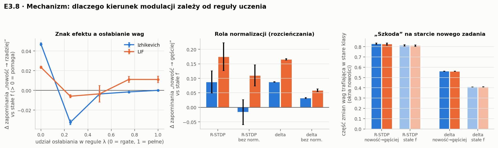
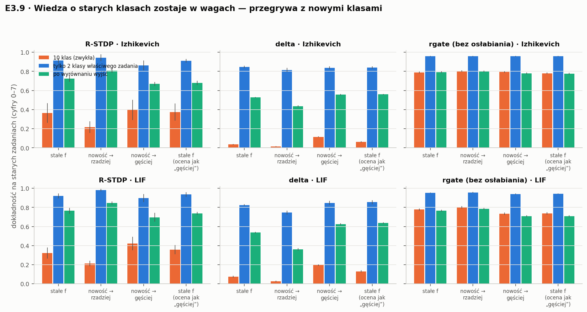
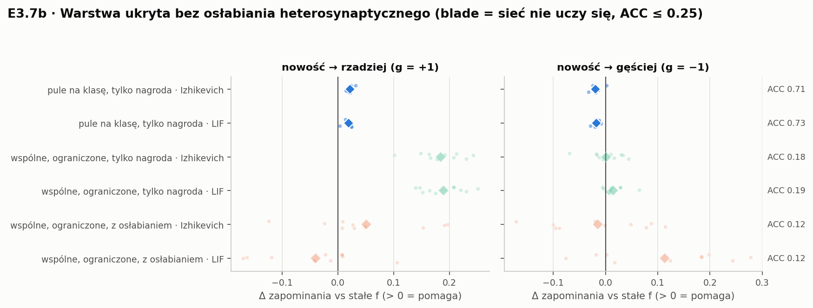

# E3 — wyniki z wyjaśnieniem wykresów

*Stan na 2026-10-31. Objaśnienia wykresów — dla czytelnika, który nie zna szczegółów. Odpowiedź w skrócie, werdykty i dalsze kroki: [README.md](README.md); wszystkie liczby: [wyniki_szczegolowe.md](wyniki_szczegolowe.md); metody: README sek. 6.*

## O co pytamy

Warstwa „DG” to 2000 neuronów impulsowych (Izhikevich albo LIF), z których każdy patrzy na
30 losowych pikseli obrazu. Hamowanie toniczne `K` (jeden prąd dla wszystkich neuronów)
ustawia, jaki odsetek neuronów **f** odpala na dany obraz — czyli jak rzadki jest kod.
Za warstwą DG jest **czytnik**: 10 neuronów wyjściowych (po jednym na cyfrę), których wagi
się uczą. Warstwa DG się nie uczy.

Pytanie E3: **czy sterowanie rzadkością sygnałem nowości („gdy coś jest nowe, koduj
rzadziej”) chroni przed zapominaniem**, gdy sieć uczy się kolejnych zadań jedno po drugim?

---

## Słowniczek

### Czytniki (reguły uczenia wag DG → wyjście)

| nazwa | jak się uczy | czego potrzebuje | osłabia wagi innych klas? |
|---|---|---|---|
| **R-STDP** | reguła trójczynnikowa: odpowiedź (jedno wyjście) jest losowana proporcjonalnie do aktywacji, potem przychodzi nagroda R = +1 (trafienie) albo −1 (pomyłka). Zmiana wagi = tempo × (R − średnia nagroda) × (czy to wyjście odpaliło − jak bardzo było „oczekiwane”) × aktywność neuronu DG | tylko nagrody (bez etykiety) | **tak** |
| **delta** | klasyczna reguła z nauczycielem: zmiana wagi = tempo × (cel − wyjście) × aktywność DG, znormalizowana | etykiety (nauczyciel) | **tak** |
| **rgate** | trójczynnikowa „bez osłabiania”: odpowiedź losowana jak w R-STDP, ale nagroda **tylko wzmacnia** wagi do wybranego wyjścia, gdy było poprawne; pomyłka nie zmienia nic | tylko nagrody | **nie** |
| **FlyModel** | wzmacnia wagi do wyjścia właściwej klasy (według etykiety), nic nie osłabia — jak w ciele grzybkowatym muszki (Shen, Dasgupta, Navlakha 2023) | etykiety | **nie** |

### Inne kody i odniesienia (tylko na wykresie 1)

| nazwa | co to jest | po co |
|---|---|---|
| **losowa projekcja** | piksele × losowa macierz Gaussa (też 2000 jednostek), potem jeden próg dla wszystkich obrazów dobrany tak, by średni odsetek aktywnych był taki sam jak w DG. Bez impulsów, bez obwodu | kontrola: czy obwód DG daje coś więcej niż dowolna losowa ekspansja o tej samej rzadkości |
| **regresja logistyczna** | standardowy klasyfikator liniowy uczony optymalnie (gradientowo, 5 epok) na tym samym kodzie DG | **sufit**: ile informacji o cyfrze w ogóle da się liniowo odczytać z kodu. To nie jest reguła biologiczna |

### Miary

- **f** — odsetek z 2000 neuronów DG, które odpaliły choć raz na dany obraz.
- **Dekorelacja (dec = r_in − r_out)** — o ile kody dwóch obrazów są mniej skorelowane niż same
  obrazy (średnia korelacja Pearsona po 2000 losowych parach obrazów testowych). Klasyczna
  miara „separacji wzorców”.
- **ACC** — końcowa dokładność: po nauczeniu wszystkich zadań, średnia dokładność na obrazach
  testowych wszystkich zadań (rozpoznawanie spośród 10 cyfr).
- **BWT (zapominanie)** — patrz niżej.

### Jak mierzymy zapominanie i jak to się ma do skuteczności

Zadanie **Split-MNIST**: 5 zadań po kolei — najpierw tylko cyfry 0 i 1, potem tylko 2 i 3,
…, na końcu 8 i 9. Czytnik jest jeden, 10-klasowy, i **nie wie**, które zadanie trwa
(scenariusz *class-incremental*, najtrudniejszy). Każde zadanie to jedna epoka (~12 000 obrazów).

Po każdym zadaniu `t` testujemy sieć na obrazach testowych **każdego** dotychczasowego zadania `j`
i zapisujemy dokładność `acc[t, j]`.

- **BWT** (backward transfer) = średnia po zadaniach 0–3 z różnicy `acc[ostatnie, j] − acc[j, j]`,
  czyli: o ile spadła dokładność na zadaniu od chwili, gdy je nauczono, do końca.
  **0 = nic nie zapomniano, −1 = zapomniano wszystko.**
- **ACC** = średnia `acc[ostatnie, j]` po wszystkich 5 zadaniach — końcowa skuteczność.

**Jak to się ma do skuteczności:** ACC łączy dwie rzeczy — czy sieć się nauczyła (plastyczność)
i czy pamięta (stabilność). Małe zapominanie **nie** oznacza automatycznie dobrej sieci: sieć,
która niczego się nie uczy, też niczego nie zapomina. Dwa wzorcowe przypadki:

- **ACC ≈ 0.2 przy BWT ≈ −1** — „pamięta tylko ostatnie zadanie”: w przybliżeniu 100% na cyfrach
  8/9 i 0% na reszcie, więc średnia ≈ 1/5. Tak wygląda katastrofalne zapominanie (np. reguła delta).
- **ACC ≈ 0.2 przy BWT ≈ 0** — „nigdy się nie nauczył”: np. reguła FlyModelu na surowym kodzie DG
  (wykres 3). Zapominanie zerowe, ale bezużyteczne.

Dlatego zawsze pokazujemy **oba**: BWT mówi, czy modulacja chroni pamięć, ACC — czy nie płacimy
za to umiejętnością uczenia się (kompromis stabilność–plastyczność).

### Kontrola, bez której wnioski byłyby fałszywe

**Stały kod o tej samej średniej rzadkości** (`fixed_matched`): gdy regulator zmienia f w czasie,
liczymy osobny przebieg ze **stałym** f równym średniemu f, jakie regulator faktycznie użył.
Bez tego nie wiadomo, czy pomaga samo *sterowanie*, czy po prostu *niższa średnia aktywność*
(rzadszy kod sam z siebie zapomina mniej). Wszystkie efekty modulacji niżej są liczone względem
tej kontroli.

---

## 1. Optimum rzadkości istnieje, a dekorelacja go nie widzi (E3.1)

**Zadanie:** zwykłe rozpoznawanie cyfr MNIST — **bez** sekwencji zadań. Czytnik uczy się na całym
zbiorze treningowym (60 000 obrazów, jedna epoka, obraz po obrazie), test na 10 000 obrazów.
Każdy punkt to inny poziom f (oś x, skala logarytmiczna, 1–90%; poziomy 70% i 90% dodane 2026-10-29
z osobnych kodów, te same sieci i η — prereg.md sek. 6k).

**Górne panele — dokładność:**
- **niebieska (DG + R-STDP)** i **pomarańczowa (DG + delta)** — ten sam kod DG, dwie reguły uczenia;
- **zielona (losowa projekcja + R-STDP)** — ten sam czytnik, ale kod bez obwodu DG;
- **szara przerywana (regresja logistyczna)** — sufit informacji w kodzie DG;
- pasma = ±SD po 5 sieciach.

**Dolne panele — dekorelacja** tego samego kodu.

**Jak czytać:**
- Dokładność rośnie, gdy kod gęstnieje od 1% do ~10–25%, potem spada (dla R-STDP wyraźnie,
  dla delty łagodnie; dlaczego R-STDP traci przy gęstym kodzie, nie badaliśmy).
  **Jest optimum przy pośredniej rzadkości.**
- Dekorelacja rośnie monotonicznie, gdy kod rzednie — najwyższa jest dla f = 1%, gdzie kod
  jest najmniej użyteczny (dokładność ~0.64). **Miara dekorelacji nagradza ciszę, nie
  użyteczność kodu** — to funkcjonalna wersja naszego wyniku z E1.
- Zielona linia jest na poziomie DG albo wyżej: **obwód DG nie daje przewagi nad losową
  ekspansją** o tej samej rzadkości (zgodnie z wcześniejszym wynikiem 1A).
- Różnica sufit–czytniki (~0.03–0.05 przy optimum) to koszt uczenia się „online”, obraz po obrazie,
  regułą lokalną zamiast optymalizacji.
- **Powyżej 50% (dodane 2026-10-29):** spadek trwa. Przy 90% R-STDP spada do ~0.55 (i bardzo różni
  się między sieciami: 0.38–0.68), delta do 0.84, sufit do 0.90–0.91. Losowa projekcja przy R-STDP
  spada tak samo (0.59 / 0.57), więc to własność czytnika przy gęstym kodzie, nie obwodu DG.
  Dekorelacja dalej maleje monotonicznie (0.20 przy 90%). Zastrzeżenie dla LIF: przy 90% hamowanie
  toniczne K ≈ −4, czyli próg ≈ 0 — neurony są na granicy strzelania bez wejścia (Izhikevich: K = 4.5,
  bez tego problemu).

---

## 2. Sterowanie rzadkością nowością — kontrasty parami (E3.3)

**Zadanie:** Split-MNIST (5 zadań po kolei, opis wyżej). Czytniki R-STDP i delta.

**Co porównujemy.** Regulator mierzy **nowość** jako niepewność czytnika (gdy dwa najaktywniejsze
wyjścia są prawie równe — sieć „nie wie”) i wygładza ją w czasie. Na granicy nowego zadania
nowość skacze ([figures/fig6_regulator_trace.png](figures/fig6_regulator_trace.png)). Warunki:

| warunek | co robi |
|---|---|
| **nowość → rzadziej** (`mod_novelty`) | gdy nowe: f spada do poziomu rzadkiego (3% R-STDP / 5–6% delta); gdy znane: wraca do gęstego (10% / 20–25%) |
| **nowość → gęściej** (`mod_novelty_inv`) | odwrotnie |
| **stałe f, ta sama średnia** (`fixed_matched`, `fixed_matched_inv`) | kontrola dla każdego z powyższych |
| **nowość → tempo uczenia** (`3f_lr`) | rzadkość stała, za to nowość zwiększa tempo uczenia (×(1 + 3·nowość)) — klasyczny „trzeci czynnik”, odpowiednik Allred & Roy 2020 |

**Jak czytać wykres:**
- Każdy **punkt** = jeden przebieg (jedna sieć × jedna kolejność obrazów); **romb** = średnia.
- **Niebieskie** = przebieg główny (sieci 0–4, 10 przebiegów); **pomarańczowe** = test
  potwierdzający na **nowych** sieciach (5–9, 10 przebiegów).
- Oś x = **różnica zapominania** (BWT pierwszego warunku − BWT drugiego).
  **Na prawo od zera: pierwszy warunek zapomina mniej. Na lewo: więcej.**
- Wiersze: 2 typy neuronów × 2 czytniki.

**Panel lewy — H-E3c: „nowość → rzadziej” vs stały kod o tej samej średniej.**
Wszystkie romby na lewo od zera, w obu zestawach sieci: rzadszy kod przy nowości **zwiększa**
zapominanie (R-STDP: −0.27 / −0.18 dla Izhikevicha, −0.20 / −0.13 dla LIF; delta: −0.02 … −0.05;
0–2 z 10 przebiegów na plus). Hipoteza obalona — **dla tych dwóch czytników**.

**Panel środkowy — H-E3d: nowość → rzadkość vs nowość → tempo uczenia.**
Romby przy zerze: oba sposoby wykorzystania sygnału nowości wypadają podobnie (p = 0.1–0.9).

**Panel prawy — H-E3e: „nowość → gęściej” vs stały kod o tej samej średniej.**
Romby na prawo: kierunek odwrotny **zmniejsza** zapominanie (+0.07 … +0.17). Przy regule delta
bardzo powtarzalnie (10/10), przy LIF + R-STDP też (9/10), ale przy Izhikevich + R-STDP w teście
potwierdzającym słabo (+0.07, 7/10, p = 0.28) — dlatego wg zapisanego z góry kryterium H-E3e
**nie została potwierdzona**, choć kierunek jest spójny.

**Skuteczność (ACC), ten sam wniosek:** np. Izhikevich + R-STDP, przebieg główny —
„nowość → rzadziej” ACC 0.27, stały kod 0.36, „nowość → gęściej” 0.39.

---

## 3. O zapominaniu decyduje reguła uczenia, nie kod (E3.4)

**Zadanie:** Split-MNIST, stała rzadkość f = 5%. Trzy kody × trzy reguły:
- **k-WTA (niebieski)** — w każdym obrazie dokładnie 100 najsilniej pobudzonych neuronów
  (jak w FlyModelu);
- **DG z globalnym progiem (pomarańczowy)** — nasz kod impulsowy;
- **DG znormalizowany per obraz (zielony)** — ten sam kod, przeskalowany tak, by każdy obraz
  miał taką samą „sumę aktywności”.

Górne panele: końcowa dokładność ACC; dolne: zapominanie BWT.

**Jak czytać:**
- **Dolne panele:** reguła FlyModelu (nie osłabia) zapomina prawie nic przy każdym kodzie;
  R-STDP i delta (osłabiają) zapominają dużo przy każdym kodzie. **Reguła, nie kod.**
- **Górny lewy słupek pomarańczowy:** reguła FlyModelu na surowym kodzie DG ma ACC 0.2 i BWT ≈ 0 —
  przypadek „nigdy się nie nauczył”. Przyczyna: przy jednym progu dla wszystkich obrazów liczba
  aktywnych neuronów waha się 18–242 (k-WTA: zawsze 100), a reguła sumująca kody faworyzuje
  klasy o „szerokich” kodach. Normalizacja per obraz odzyskuje większość (0.50–0.55), ale k-WTA
  nadal wygrywa.
- **Wniosek biologiczny:** samo hamowanie toniczne (globalny próg) nie wyrównuje aktywności
  między wzorcami; robi to hamowanie zależne od aktywności (k-WTA).

---

## 4. Czy obalenie jest odporne? Sześć architektur × trzy reguły (E3.5) — najważniejszy wykres

**Zadanie:** Split-MNIST, jak w punkcie 2, ale z **krzywą dawka–odpowiedź**: siła modulacji
**g** od −1 do +1 (oś x):
- g = +1 — pełne „nowość → rzadziej” (jak w punkcie 2),
- g = +0.5 — połowa tej zmiany,
- g = 0 — stały kod,
- g = −0.5, −1 — „nowość → gęściej”.

Oś y — **o ile modulacja zapomina mniej niż stały kod o tej samej średniej rzadkości**
(> 0 = pomaga). Kolory — 6 architektur warstwy DG: liczba neuronów N (500, 1000, 2000, 5000)
i liczba pikseli na neuron (fan-in 10, 30, 100). Wiersze — trzy reguły czytnika; kolumny —
dwa typy neuronów. Słupki błędów = błąd standardowy (6–10 przebiegów).

**Jak czytać:**
- **R-STDP i delta (dwa górne wiersze):** krzywe opadają w prawo we wszystkich 24 komórkach —
  im silniej „nowość → rzadziej”, tym więcej zapominania. Przy regule delta efekt rośnie
  z rozmiarem warstwy i fan-in.
- **rgate (dolny wiersz):** krzywe rosną w prawo we wszystkich 12 komórkach — „nowość → rzadziej”
  **zmniejsza** zapominanie (+0.02 … +0.05; 6/6 albo 10/10 przebiegów na plus).
- **Kierunek nie zależy od architektury, tylko od reguły uczenia.** To odpowiedź na pytanie,
  czy obalenie z punktu 2 jest ostateczne: nie jest.

**Skuteczność:** przy rgate efekt jest mały, bo rgate sam prawie nie zapomina (BWT ≈ −0.08),
i ma koszt: dla Izhikevicha końcowa ACC spada (0.73 vs 0.77 przy stałym kodzie), dla LIF się
nie zmienia (0.75 vs 0.75). To kompromis stabilność–plastyczność: rzadszy kod przy nowości
chroni stare wagi, ale nowe zadanie uczy się na mniejszej liczbie neuronów.

---

## 5. Zadanie separacji wzorców na modelu skalibrowanym do skrawka (E3.6x)

**Zadanie:** nie MNIST, tylko „nasze” zadanie z `dg_core` (jak w wyniku 1A): 10 prototypów
wzorców wejściowych o zadanym wzajemnym podobieństwie **R_in** (0.5, 0.75, 0.9), każda próba =
prototyp z szumem (20% przełączonych włókien), uczone parami jedna po drugiej (jak Split-MNIST).
Model: pełny obwód `dg_core` w Brian2 (200 GC, FS, HMC) **skalibrowany do danych Madara ze
skrawka**: wejście to salwy stymulacji, a nie ciągłe tło; zgodność z danymi: GC 3.0 Hz,
R_w 0.37, R_b 0.28, FS 9.6 Hz.

Oś x i y jak w punkcie 4; panele = czytniki; kolory = podobieństwo wzorców R_in.

**Jak czytać:**
- **Mało podobne wzorce (R_in 0.5, niebieski):** „nowość → rzadziej” pomaga (R-STDP +0.13,
  rgate +0.02; 6/6).
- **Bardzo podobne wzorce (R_in 0.9, zielony):** „nowość → rzadziej” szkodzi (R-STDP −0.13),
  a pomaga kierunek odwrotny, „nowość → gęściej” (+0.08 … +0.48).
- **Reguła delta** zapomina silnie przy każdej modulacji w stronę „rzadziej” (−0.3 … −0.6).
- Przy rgate efekty są małe (≤ 0.03) — na tej skali krzywe wyglądają płasko.
- **Zgodność z biologią:** Pérez-Montoyo i in. 2026 (PLoS Biol): słabsze hamowanie w DG podczas
  kodowania **podobnych** doświadczeń poprawia ich późniejsze rozróżnianie. „Nowość → gęściej”
  przy podobnych wzorcach to dokładnie słabsze hamowanie przy nowym, podobnym wzorcu.

**Zastrzeżenia:** przy R_in 0.75–0.9 końcowe dokładności są niskie (0.15–0.30 przy 10 klasach),
więc te wiersze rozstrzygają słabiej; model skrawka nie odtwarza jeszcze siły efektu gabazyny
(×1.25 vs ×1.6 w danych).

---

## 6. Dlaczego kierunek zależy od reguły? Test mechanizmu (E3.8)

Kolory w całej figurze: **niebieski = Izhikevich, pomarańczowy = LIF**.

**Lewy panel — rola osłabiania wag.** Reguła `rmix` to `rgate` z dodanym osłabianiem: przy
pomyłce wagi do wybranego wyjścia maleją o λ razy tyle, o ile rosną przy trafieniu (λ = 0 to
czysty `rgate`). Oś y: o ile „nowość → rzadziej” zapomina mniej niż stały kod o tej samej średniej.
Przy λ = 0 pomaga (10/10), ale **już λ = 0.25 odwraca znak** (szkodzi w 10/10 i 9/10). Przy
λ ≥ 0.5 reguła prawie przestaje się uczyć (końcowa dokładność spada do ~0.2), więc różnice
znikają. Wniosek: o kierunku decyduje już samo pojawienie się osłabiania.

**Środkowy panel — rola normalizacji per obraz.** Przewaga „nowość → gęściej” dla R-STDP i delty
z normalizacją (słupki 1 i 3) i bez niej (2 i 4). Dla reguły delta bez normalizacji przewaga maleje
mniej więcej o połowę (istotnie dla obu neuronów); dla R-STDP różnica nieistotna.

**Prawy panel — „szkoda” na starcie nowego zadania.** Jaka część wszystkich zmian wag w pierwszych
300 obrazach każdego nowego zadania trafia w wagi starych klas, na neuronach, z których są
odczytywane. Ciemne słupki: „nowość → gęściej”; jasne: stały kod o tej samej średniej, oceniany na
tym samym poziomie. **Wbrew hipotezie „rozcieńczania” przy „nowość → gęściej” szkody jest więcej**
(dla delty 0.56 vs 0.41), a mimo to zapominanie jest mniejsze. Czyli przewaga tego kierunku przy
regułach z osłabianiem bierze się z czegoś innego — kandydat: zapominanie w tym scenariuszu to
głównie przewaga nowych klas na starych obrazach, a nie zniszczenie starych wag — potwierdzone
w sekcji 7 (E3.9).

Dodatkowo (bez wykresu): przewaga „nowość → gęściej” **przetrwała kontrolę poziomu oceny**
(stały kod oceniany na tym samym rzadkim poziomie) — dla delty 10/10, dla R-STDP kierunek zgodny.

## 7. Skąd zapominanie: zniszczenie wag czy przewaga nowych klas? (E3.9)

**Co jest na wykresie.** Dokładność na obrazach testowych *starych* zadań (cyfry 0–7) po nauce
wszystkich pięciu zadań, mierzona na trzy sposoby:
- **pomarańczowy, 10 klas:** zwykła dokładność — sieć wybiera spośród wszystkich 10 cyfr
  (to ona wchodzi do miary zapominania BWT);
- **niebieski, 2 klasy właściwego zadania:** pytamy sieć tylko „0 czy 1?” dla obrazu 0 lub 1 itd.
  Jeśli ten słupek jest wysoki, wiedza o starych klasach nadal jest w wagach;
- **zielony, po wyrównaniu wyjść:** każde wyjście sprowadzamy do tej samej średniej i rozrzutu
  (na próbce obrazów wszystkich klas), a potem wybieramy jak zwykle spośród 10 klas.

Kolumny to czytniki, wiersze — typy neuronu, grupy słupków — warunki (stałe f, oba kierunki
sterowania, stałe f oceniane na tym samym poziomie co „gęściej”). 10 przebiegów, wąsy = SD.

**Jak czytać.** Przy R-STDP i delcie pomarańczowy słupek jest niski (0.04–0.4), a niebieski wysoki
(0.8–0.95): sieć *wie*, czym różni się 0 od 1, ale na obrazie 0 wygrywa wyjście nowszej klasy
(96–100% błędów to klasy nowszych zadań, dla delty prawie zawsze 8 lub 9). To jest **przewaga
nowych klas**, nie zniszczenie wiedzy. Samo wyrównanie wyjść (zielony) odzyskuje sporą część
dokładności. „Nowość → gęściej” zmniejsza właśnie przejmowanie przez nowe klasy (dla delty przy tej
samej wiedzy w obrębie zadania), a „nowość → rzadziej” je zwiększa. Przy rgate wszystkie trzy słupki
są wysokie i prawie równe — ta reguła prawie nie zapomina i nie ma przechylenia w stronę nowych klas.

**Wniosek:** przy regułach z osłabianiem kierunek modulacji rzadkości steruje głównie przechyleniem
wyjść w stronę nowych klas. Kryterium zapisane przed uruchomieniem spełnione dla delty; dla R-STDP
kierunek zgodny, ale niespójny między przebiegami.

## 8. Sieć z warstwą ukrytą (E3.7, E3.7b, E3.9h)

**Sieć:** kod DG → 500 jednostek ukrytych → 10 wyjść; obie warstwy uczone trójczynnikowo (AGREL:
nagroda × sygnał zwrotny od wybranego wyjścia). Pytanie: czy zasada z punktu 4 przenosi się na
sieć, w której uczy się też warstwa pośrednia?

**Trzy kroki:**
1. **E3.7** (fig. 11): wersja z osłabianiem i „bez” zapominają prawie wszystko (ACC ≈ 0.17).
   „Bez osłabiania” nim w praktyce nie było — normalizacja wag każdej jednostki ukrytej,
   wspólnej dla wszystkich klas, działa jak osłabianie.
2. **E3.7b** (wykres wyżej): trzy warianty bez tej normalizacji. Punkty — przebiegi, romb — średnia;
   oś x: o ile sterowanie zapomina mniej niż stałe f o tej samej średniej; blade wiersze — warianty,
   które się nie uczą (ACC ≤ 0.25), więc nie rozstrzygają.
   - **Pule jednostek przypisane klasom (niebieskie):** uczą się dobrze (ACC 0.71–0.73) i zachowują
     jak rgate — „nowość → rzadziej” pomaga 20/20, „nowość → gęściej” szkodzi.
   - **Wspólne jednostki bez normalizacji (zielone, pomarańczowe):** nadal zapominają prawie wszystko,
     nawet bez żadnego osłabiania.
3. **E3.9h** — diagnoza z sekcji 7 dla tych sieci (przy stałym f):

| sieć | 10 klas | tylko 2 klasy właściwego zadania | błędy → nowsze klasy |
|---|---|---|---|
| wspólna warstwa, bez normalizacji (`pos_bound`) | 0.08–0.09 | **0.61–0.62** | 97% |
| wspólna warstwa z normalizacją (`agrel_pos`, E3.7) | 0.00 | **0.62–0.67** | 100% |
| pule na klasę (`pos_pool`) | 0.75–0.77 | 0.90–0.94 | 47% |
| *dla porównania: czytnik liniowy delta (sekcja 7)* | *0.04–0.08* | *0.83–0.85* | *100%* |

**Wniosek:** we wspólnej warstwie ukrytej nawet wybór „0 czy 1?” jest bliski losowego (0.50) —
wiedza o starych klasach jest naprawdę niszczona, inaczej niż w czytniku liniowym. „Nowość → rzadziej”
w `pos_bound` pomaga głównie zmniejszając przejmowanie (błędy → ostatnie zadanie 0.59 → 0.20), a wiedzę
chroni tylko trochę (+0.03). Zasada z punktu 4 obowiązuje tam, gdzie sieć się uczy (pule na klasę).

---

## Podsumowanie

1. **Kierunek efektu „nowość → rzadszy kod” wyznaczają reguła uczenia sieci i podobieństwo
   wzorców.** Przy regułach osłabiających wagi innych klas szkodzi; przy regule, w której
   nagroda bramkuje tylko wzmacnianie, pomaga — w każdej architekturze. Na zadaniu separacji
   pomaga dla mało podobnych wzorców, a dla bardzo podobnych lepszy jest kierunek odwrotny.
2. **Bez kontroli o tej samej średniej rzadkości wnioski o modulacji są niewiarygodne** —
   część pozornego zysku to po prostu niższa aktywność.
3. **Miara dekorelacji nie wskazuje rzadkości użytecznej dla uczenia** — nagradza ciszę.
4. **O zapominaniu bardziej niż rzadkość decyduje reguła czytnika**, a do dobrego kodu potrzebne
   jest wyrównanie aktywności między wzorcami, którego samo hamowanie toniczne nie zapewnia.
5. **Wystarczy niewielkie osłabianie wag, by odwrócić kierunek efektu** (E3.8). Dlaczego przy
   osłabianiu pomaga kierunek „nowość → gęściej”, wyjaśnia E3.9 (sekcja 7): zapominanie przy takich regułach
   to głównie przewaga nowych klas (wiedza zostaje, przegrywa), a gęstszy kod przy nowości
   ogranicza przejmowanie starych obrazów przez nowe klasy.
6. **Zasada przenosi się na sieć z warstwą ukrytą, jeśli jednostki ukryte nie są wspólne dla klas**
   (E3.7b, sekcja 8); wspólna warstwa ukryta zapomina prawie wszystko niezależnie od reguły — i tam, inaczej
   niż w czytniku liniowym, wiedza jest naprawdę niszczona, nie tylko przegrywa (E3.9h).
